# Guide d'installation et d'exploitation

<div class="iw-pdf" markdown>[:octicons-download-16: Télécharger le PDF v2.0](pdf/ILLWATCH_Guide_installation_exploitation_v2.pdf){ .md-button } [:material-home: Toute la documentation](README.md){ .md-button }</div>

**Version 2.0 du 30/10/2026** · ILLWATCH `0.2.0.dev0` · Public : responsable sécurité, administrateur système, analyste SOC

Ce guide installe ILLWATCH sur un ordinateur ou un serveur, le remplit de renseignement, le relie à
**vos** actifs, puis l'exploite au quotidien. Pour comprendre en profondeur ce que fait chaque
fonctionnalité, voir le [Manuel fonctionnel](MANUEL_FONCTIONNEL.md).

!!! tip "Comment lire ce guide"
    Chaque tâche est présentée de la façon la plus simple d'abord. Quand elle existe, vous
    trouverez ensuite deux méthodes :

    - **Dans l'application** : l'écran, le bouton et le résultat attendu ;
    - **En ligne de commande** : la commande exacte, à lancer dans un terminal où
      l'environnement Python d'ILLWATCH est activé.

    Les deux méthodes produisent exactement le même résultat et sont consignées de la même façon
    au journal d'audit.

## Sommaire

1. [Avant de commencer](#1-avant-de-commencer)
2. [Installer ILLWATCH](#2-installer-illwatch)
3. [Premier démarrage](#3-premier-demarrage)
4. [Brancher les sources de renseignement](#4-brancher-les-sources-de-renseignement)
5. [Déclarer votre inventaire (méthode Excel)](#5-declarer-votre-inventaire-methode-excel)
6. [Remplir la base](#6-remplir-la-base)
7. [Le travail quotidien](#7-le-travail-quotidien)
8. [Administrer la plateforme](#8-administrer-la-plateforme)
9. [Exploiter dans la durée](#9-exploiter-dans-la-duree)
10. [Passer sur un serveur](#10-passer-sur-un-serveur)
11. [Dépannage](#11-depannage)
12. [Aide-mémoire](#12-aide-memoire)

---

## 1. Avant de commencer

### Ce qui va tourner sur votre machine

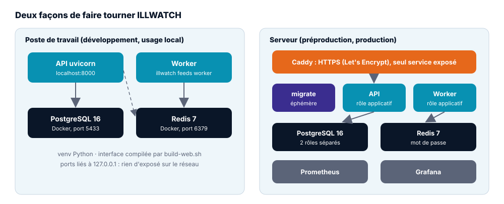

| Composant | Rôle | Où il tourne |
|---|---|---|
| **PostgreSQL 16** | toutes les données : IOC, CVE, incidents, journal d'audit | conteneur Docker |
| **Redis 7** | verrous du collecteur, limitation des connexions, temps réel | conteneur Docker |
| **API** | REST `/api/v1`, interface web, `/metrics`, serveur TAXII | environnement Python (`uvicorn`) |
| **Worker** | collecte continue, CVE toutes les 6 h, corrélation chaque heure, chasse et entretien quotidiens | environnement Python (`illwatch feeds worker`) |

Ce guide décrit l'installation **sur un poste** (colonne de gauche du schéma) : c'est la façon la
plus directe de commencer. Le passage sur un serveur exposé en HTTPS est décrit à la
[section 10](#10-passer-sur-un-serveur).

### Configuration matérielle conseillée

| Usage | Processeur | Mémoire | Disque |
|---|---|---|---|
| Essai, démonstration | 2 cœurs | 4 Go | 10 Go |
| Exploitation réelle (500 000 IOC et plus) | 2 à 4 cœurs | 4 à 8 Go | 40 Go |

ILLWATCH lui-même tient dans moins de 256 Mo de mémoire ; le reste sert à PostgreSQL et au
système.

### Les durées à prévoir

| Étape | Durée |
|---|---|
| Préparer la machine, installer, configurer | 30 à 45 minutes |
| Première synchronisation des CVE | 10 minutes avec une clé NVD, jusqu'à une heure sans |
| Premier remplissage des IOC (historique OTX compris) | 30 minutes à quelques heures |
| Déclarer l'inventaire avec le modèle Excel | selon la taille du parc |

---

## 2. Installer ILLWATCH

Les commandes sont écrites pour **Linux** (Kali, Debian 13, Ubuntu 24.04). Sous **Windows**,
installez WSL2 avec Ubuntu 24.04 et Docker Desktop, puis suivez les mêmes commandes dans le
terminal Ubuntu. Sous **macOS**, installez Python et Node.js avec Homebrew, et Docker Desktop.

### 2.1 Préparer la machine

```bash
sudo apt update
sudo apt install -y git python3 python3-venv python3-pip docker.io docker-compose openssl jq tmux
sudo systemctl enable --now docker
sudo usermod -aG docker $USER      # puis fermez la session et reconnectez-vous
```

Le groupe `docker` permet d'utiliser Docker sans `sudo` ; il ne prend effet qu'après une
reconnexion. Vérifiez ensuite les versions :

```bash
python3 --version          # 3.12 ou plus
docker compose version     # v2 (sinon la commande s'écrit docker-compose)
node --version             # 20.19 ou plus (interface web)
```

| Si… | Alors… |
|---|---|
| Python est en 3.11 (Debian 12) | installez Python 3.12 ou passez à Debian 13 |
| Node.js manque ou est trop ancien (Ubuntu 24.04 fournit la 18) | installez Node 22 avec `nvm` ou le dépôt NodeSource |
| un service occupe déjà 5433, 6379 ou 8000 (`ss -ltnp`) | arrêtez-le ou changez le port dans `docker-compose.yml` |

### 2.2 Récupérer le code

```bash
cd ~
git clone https://gitlab.com/GodwillFoka/cyberillsec-illwatch.git
cd cyberillsec-illwatch
python3 -m venv .venv
source .venv/bin/activate
pip install --upgrade pip
pip install -c constraints.txt -e ".[dev]"
illwatch version
```

GitLab est le dépôt de référence ; GitHub en est le miroir. L'environnement virtuel `.venv`
isole les bibliothèques d'ILLWATCH de celles du système, et `constraints.txt` installe exactement
les versions vérifiées par l'intégration continue.

!!! warning "Le réflexe à prendre"
    Dans **chaque nouveau terminal**, commencez par
    `cd ~/cyberillsec-illwatch && source .venv/bin/activate`.
    Sans cela, la commande `illwatch` est introuvable.

### 2.3 Écrire la configuration (`.env`)

```bash
cp .env.example .env
chmod 600 .env
openssl rand -hex 32        # à copier dans SECRET_KEY
nano .env
```

| Variable | Valeur à mettre | À quoi elle sert |
|---|---|---|
| `SECRET_KEY` | la valeur générée ci-dessus | signe les jetons de connexion |
| `DEFAULT_LANGUAGE` | `fr` | langue de l'interface et des textes produits par le serveur |
| `INSTANCE_COUNTRY` | `FR`, `DE`… | pays de l'instance, pour les visiteurs du réseau interne |
| `NVD_API_KEY` | votre clé NVD | synchronisation des CVE dix fois plus rapide |
| `OTX_API_KEY` | votre clé AlienVault OTX | la source d'IOC la plus riche |
| `ABUSECH_AUTH_KEY` | votre clé abuse.ch | obligatoire pour URLhaus |
| `TAXII_AUTH` | voir ci-dessous | accès aux serveurs TAXII (DigitalSide, RedEye) |
| `OTX_MAX_PAGES` | `200` pour la première collecte, puis `20` | rattraper l'historique OTX |
| `ALERT_WEBHOOK_URL` | adresse d'un webhook Slack ou Mattermost (facultatif) | recevoir les alertes CVE |
| `RISK_ALERT_THRESHOLD` | `75` (valeur par défaut) | score à partir duquel une CVE déclenche une alerte |

```bash
TAXII_AUTH=osint.digitalside.it=guest:guest;feeds.redeyesecurity.com=bearer:rdi_VOTRE_JETON
```

| Clé | Où l'obtenir (gratuit) |
|---|---|
| NVD | nvd.nist.gov/developers/request-an-api-key |
| AlienVault OTX | otx.alienvault.com, rubrique « API » de votre profil |
| abuse.ch | auth.abuse.ch |
| RedEye | inscription par e-mail auprès de RedEye Security |

Les adresses de la base et de Redis du modèle conviennent telles quelles pour un poste : les
deux services n'écoutent que sur `127.0.0.1`, rien n'est exposé au réseau.

!!! danger "Secrets"
    Le fichier `.env` contient vos clés. Ne l'envoyez jamais par messagerie et ne l'ajoutez jamais
    au dépôt Git (il est ignoré par défaut). Pour reprendre les clés d'un autre poste, copiez-les
    par un moyen sûr (clé USB, `scp`, gestionnaire de mots de passe).

### 2.4 Démarrer la base de données

```bash
docker compose up -d postgres redis
docker compose ps          # les deux services doivent être « healthy »
```

Au premier démarrage, PostgreSQL crée deux rôles : `illwatch`, propriétaire, réservé aux
migrations, et `illwatch_app`, utilisé par l'application, **sans droit de modifier la
structure**. Les volumes `illwatch_pgdata` et `illwatch_redisdata` survivent aux redémarrages.

### 2.5 Créer le schéma, les sources et les comptes

Choisissez **une** des deux options.

**Option A : instance neuve**

```bash
illwatch db init          # schéma et droits du rôle applicatif
illwatch seed             # les 9 sources de référence vérifiées
illwatch users create --username admin --email vous@exemple.org --role admin
```

**Option B : reprendre les données d'un autre poste**

Sur l'**ancien** poste, `scripts/backup.sh` crée `backups/illwatch-AAAAMMJJThhmmssZ.dump` et son
empreinte `.sha256`. Copiez les deux fichiers dans `~/cyberillsec-illwatch/backups/` du
**nouveau** poste, puis :

```bash
cd ~/cyberillsec-illwatch/backups && sha256sum -c illwatch-*.sha256 && cd ..
scripts/restore.sh backups/illwatch-AAAAMMJJThhmmssZ.dump
illwatch db upgrade       # migrations éventuelles et droits du rôle applicatif
```

Ne lancez ni `seed` ni `users create` : sources, comptes et historique arrivent avec la
sauvegarde.

!!! warning "Toujours `illwatch db upgrade`"
    N'utilisez jamais `alembic upgrade head` seul : il ne donne pas au rôle applicatif ses droits
    sur les nouvelles tables, et l'application échoue ensuite sur `permission denied for table`.

### 2.6 Construire l'interface web

```bash
./scripts/build-web.sh
```

Le script exporte le schéma de l'API, installe les dépendances verrouillées, génère les types et
compile l'interface dans `frontend/dist/`, que l'API sert ensuite à la racine du site. Relancez-le
après chaque mise à jour du code.

### 2.7 Lancer le service

Il faut deux processus permanents. `tmux` les garde actifs même si vous fermez le terminal :

```bash
cd ~/cyberillsec-illwatch
tmux new -s illwatch
source .venv/bin/activate
uvicorn illwatch.app.main:app --host 127.0.0.1 --port 8000
# Ctrl+B puis C : seconde fenêtre
source .venv/bin/activate
illwatch feeds worker
# Ctrl+B puis D pour détacher ; « tmux attach -t illwatch » pour revenir
```

Vérification :

```bash
curl -s localhost:8000/ready | jq      # « ready », base et schéma à jour, Redis joignable
```

Ouvrez **http://localhost:8000/** : l'écran de connexion s'affiche.

---

## 3. Premier démarrage

### 3.1 Se connecter

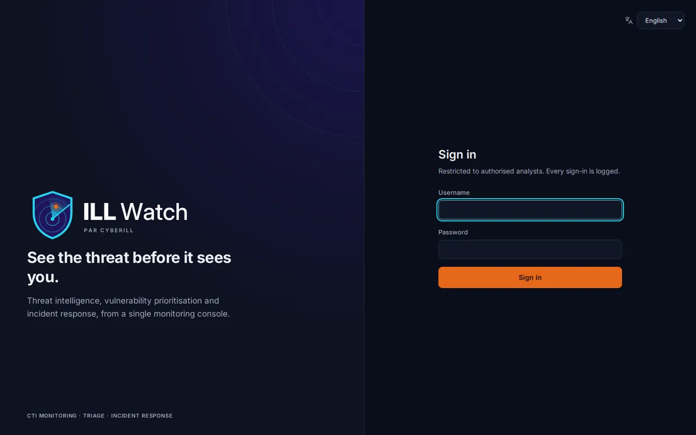

*Figure : l'écran de connexion (choix de la langue en haut).*

Saisissez l'identifiant et le mot de passe créés à l'étape 2.5. La langue se choisit sur
l'écran de connexion et à tout moment dans la barre supérieure (français, anglais, allemand,
espagnol, chinois).

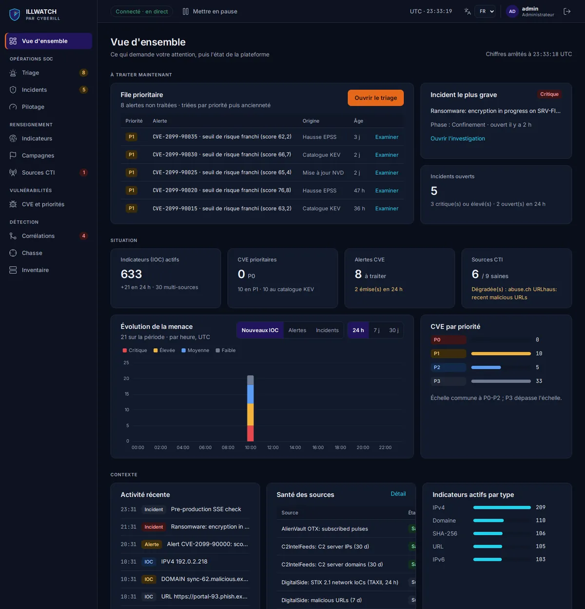

*Figure : la vue d'ensemble, premier écran après la connexion (jeu de démonstration).*

L'écran est organisé en trois bandeaux : **À traiter maintenant** (file des alertes, incident le
plus grave), **Situation** (IOC actifs, CVE prioritaires, alertes, santé des sources) et
**Contexte** (activité récente, santé des sources, IOC par type). Les chiffres se mettent à jour
en direct ; le bouton « Mettre en pause » fige l'affichage pendant une lecture.

### 3.2 Créer les comptes de l'équipe

Un compte par personne, jamais de compte partagé : le journal d'audit attribue chaque action à
son auteur.

| Rôle | Peut faire |
|---|---|
| **Administrateur** | tout : comptes, sources, paramètres, suppressions, journal d'audit |
| **Analyste** | trier, enquêter, ouvrir et faire avancer les incidents, chasser, déclarer l'inventaire, écarter les faux positifs |
| **Lecteur** | tout consulter, sans rien modifier ; sert aussi aux partenaires TAXII |

**Dans l'application** : *Administration*, onglet *Comptes*, bouton **Nouveau compte**. Le bouton
**Générer** propose un mot de passe robuste (12 caractères au moins) à transmettre par un canal
sûr.

**En ligne de commande** :

```bash
illwatch users create --username alice --email alice@exemple.org --role analyst
illwatch users create --username lecteur --email soc@exemple.org --role viewer
```

---

## 4. Brancher les sources de renseignement


`illwatch seed` a déclaré neuf sources vérifiées : abuse.ch URLhaus et Feodo Tracker,
C2IntelFeeds (adresses et domaines), IPsum, RedEye et DigitalSide (TAXII 2.1), DigitalSide
(URL) et AlienVault OTX. Les catalogues de vulnérabilités (NVD, CISA KEV, FIRST EPSS) ne sont pas
des « sources » au sens de cet écran : le moteur CVE les interroge directement.

### 4.1 Vérifier l'état des sources

**Dans l'application** : écran **Sources CTI**. Chaque source affiche son état (*saine*,
*dégradée*, *en attente*, *suspendue*), son dernier succès, ses nouveaux IOC et son taux de
réussite sur 7 jours. Un clic ouvre le détail : adresse, format, fiabilité, fréquence et
dernières collectes.

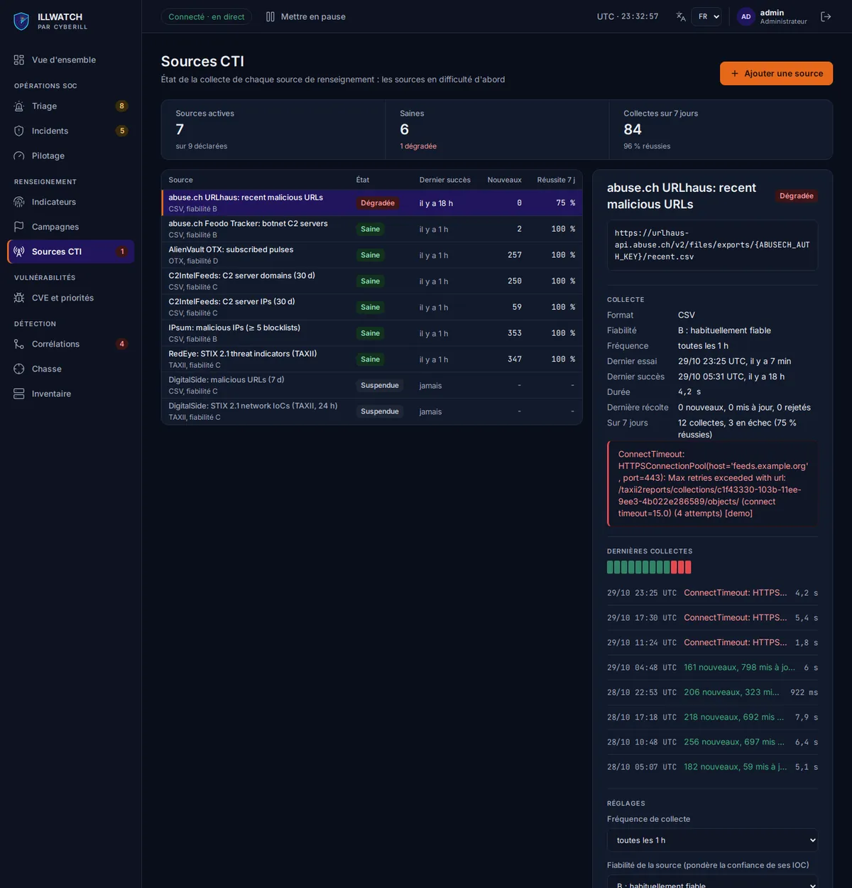

*Figure : l'écran Sources CTI.*

**En ligne de commande** :

```bash
illwatch feeds list
illwatch feeds probe "AlienVault OTX : pulses abonnés"   # répond ? identifiants acceptés ? IOC produits ?
```

### 4.2 Régler une source

| Action | Dans l'application (administrateur) | En ligne de commande |
|---|---|---|
| Suspendre ou reprendre | *Sources CTI*, détail, **Suspendre la collecte** / **Reprendre la collecte** | `illwatch feeds disable "<nom>"` / `enable` |
| Changer la fréquence ou la fiabilité | *Sources CTI*, détail, rubrique *Réglages* | (application ou API) |
| Ajouter une source | *Sources CTI*, **Ajouter une source** | `illwatch feeds add --name "…" --url https://… --type CSV` |
| Collecter tout de suite | (le worker collecte automatiquement) | `illwatch feeds fetch "<nom>"` ou `fetch-all --force` |
| Supprimer | détail, **Supprimer** (les IOC sont conservés) | (application ou API) |

La **fiabilité** suit l'échelle de l'Amirauté, de A (« sûre ») à F (« impossible à juger ») :
elle pondère la confiance des IOC de la source. Une adresse de flux doit être publique et en
HTTPS ; les adresses internes sont refusées (protection contre la falsification de requêtes
côté serveur, SSRF).

!!! note "Source en panne"
    Une source injoignable passe en *dégradée* sans bloquer les autres ; le worker espace ses
    essais (1, 2, 4 minutes…) jusqu'à l'intervalle normal. `illwatch feeds probe` dit pourquoi.

---

## 5. Déclarer votre inventaire (méthode Excel)

La **corrélation** (voir le [Manuel fonctionnel](MANUEL_FONCTIONNEL.md#5-correlation-le-renseignement-rapporte-a-vos-actifs))
confronte le renseignement à **vos** produits, adresses et domaines. Sans inventaire, elle ne
produit rien. La façon la plus simple de le déclarer est un fichier Excel.

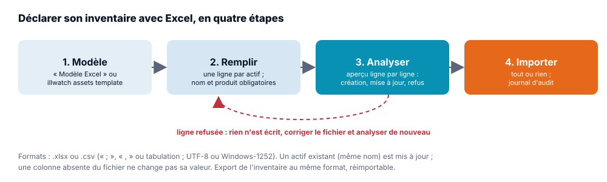

### 5.1 Télécharger le modèle

**Dans l'application** : écran **Inventaire**, bouton **Importer un fichier**, puis
**Modèle Excel**. Le fichier `illwatch-modele-inventaire.xlsx` contient deux onglets :
*Inventaire*, à remplir, et *Mode d'emploi*.

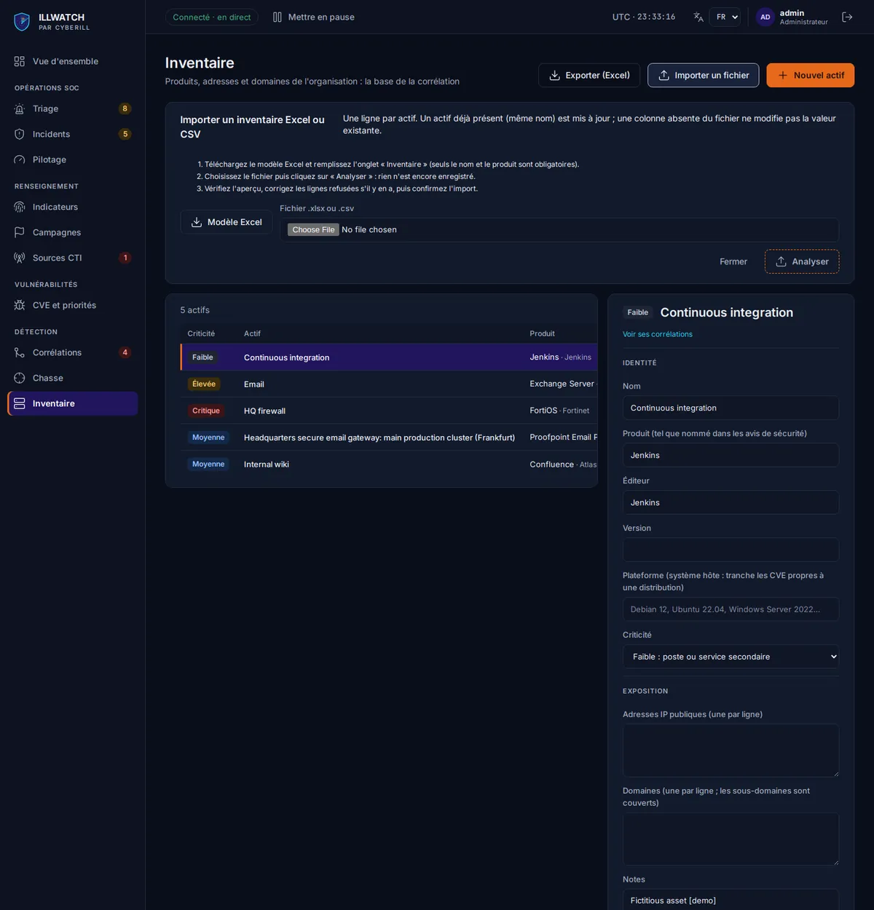

*Figure : le panneau d'import de l'écran Inventaire, avec ses trois étapes.*

**En ligne de commande** :

```bash
illwatch assets template                     # crée modele-inventaire.xlsx
illwatch assets template -o modele.csv       # ou un modèle CSV
```

### 5.2 Remplir le fichier

Une ligne par actif. Seuls **nom** et **produit** sont obligatoires.

| Colonne | Contenu | Exemple |
|---|---|---|
| `nom` | nom unique de l'actif dans votre organisation | Pare-feu siège |
| `produit` | nom du produit **tel qu'il apparaît dans les avis de sécurité** (3 caractères au moins) | FortiOS |
| `editeur` | éditeur ou fabricant | Fortinet |
| `version` | version installée, saisie en texte | 7.2.5 |
| `plateforme` | système hôte, pour les CVE propres à une distribution | Debian 12 |
| `criticite` | Critique, Élevée, Moyenne ou Faible (Moyenne si vide) | Critique |
| `adresses` | adresses IP publiques exposées, séparées par des espaces ou des virgules | 198.51.100.10 |
| `domaines` | domaines exposés ; un domaine couvre ses sous-domaines | vpn.example.com |
| `notes` | commentaire libre | Cluster principal |
| `en_service` | oui ou non (oui si vide) ; un actif hors service n'est plus corrélé | oui |

Exemple d'inventaire rempli :

| nom | produit | editeur | version | criticite | adresses | domaines |
|---|---|---|---|---|---|---|
| Pare-feu siège | FortiOS | Fortinet | 7.2.5 | Critique | 198.51.100.10 | vpn.example.com |
| Messagerie | Exchange Server | Microsoft | 2019 CU14 | Élevée | 198.51.100.25 | mail.example.com |
| Wiki interne | Confluence | Atlassian | 8.5.3 | Moyenne | | |
| Serveur d'intégration | Jenkins | Jenkins | 2.452 | Faible | | ci.example.com |

!!! tip "Bien nommer les produits"
    Le produit est cherché **en mot entier** dans la description des CVE. Écrivez-le comme
    l'éditeur le nomme dans ses avis : « Exchange Server », « FortiOS », « Confluence ». Un nom
    trop vague comme « Windows » produit du bruit ; précisez « Windows Server 2019 ».
    **Renseignez la version** : sans elle, la corrélation ne peut pas écarter les versions non
    vulnérables (sur données réelles, la première passe sans version a produit environ 80 % de
    faux positifs).

Le modèle met toutes les colonnes au format texte (Excel ne transforme donc pas « 7.10 » en 7,1)
et propose des listes de choix pour la criticité et `en_service`.

### 5.3 Analyser, puis importer

**Dans l'application** :

1. écran **Inventaire**, bouton **Importer un fichier** ;
2. choisissez le fichier `.xlsx` ou `.csv`, puis **Analyser** : rien n'est encore enregistré ;
3. l'aperçu liste chaque ligne avec son résultat : *Sera créé*, *Sera mis à jour*, ou le motif du
   refus ;
4. s'il n'y a aucun refus, cliquez sur **Importer N actifs**.

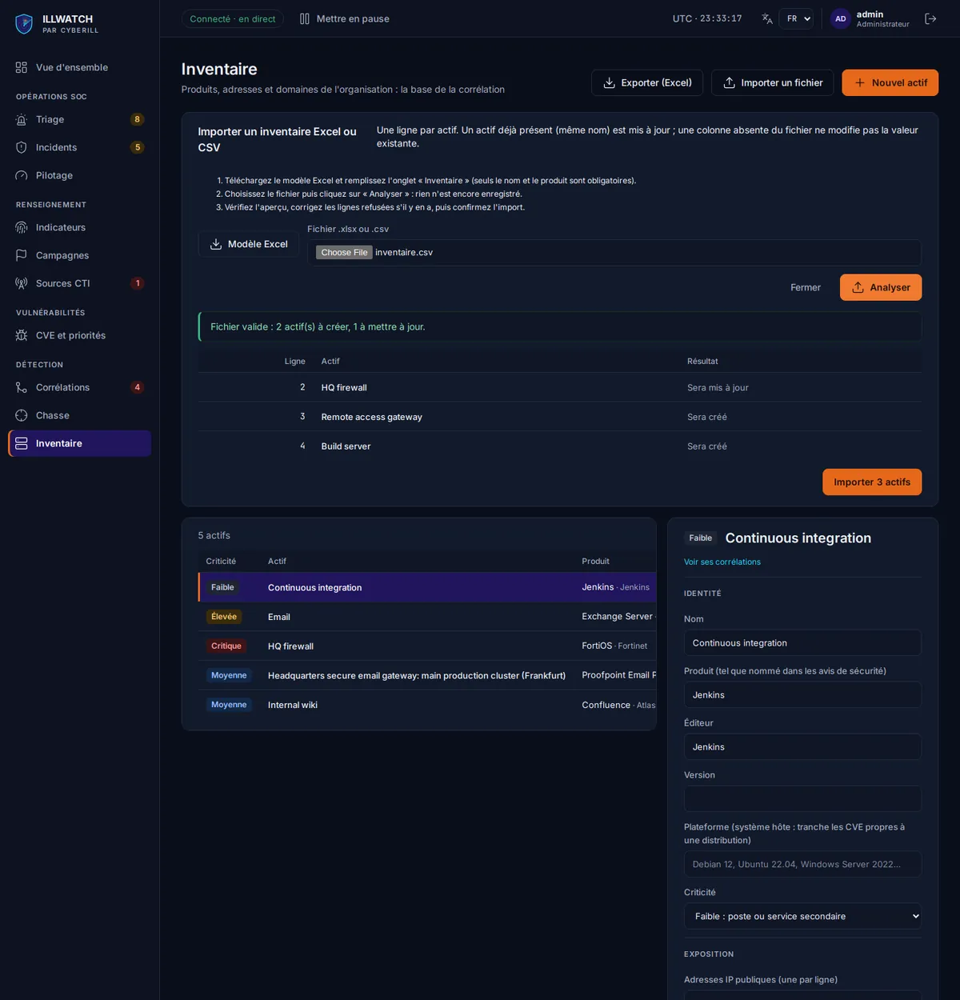

*Figure : l'aperçu d'un import, avant confirmation.*

**En ligne de commande** :

```bash
illwatch assets import inventaire.xlsx --dry-run   # aperçu, rien n'est écrit
illwatch assets import inventaire.xlsx             # import
```

**Règles de l'import**

- **Tout ou rien** : si une seule ligne est refusée, rien n'est importé. L'aperçu donne le numéro
  de ligne et le motif ; corrigez le fichier puis analysez-le de nouveau.
- **Un actif est reconnu par son nom** : présent, il est mis à jour ; absent, il est créé.
  Renommer un actif dans le fichier crée donc un nouvel actif.
- **Une colonne absente du fichier ne change rien** : un fichier sans colonne `notes` ne vide pas
  les notes existantes.
- Formats acceptés : `.xlsx` (onglet « Inventaire », ou le premier onglet) et `.csv` avec `;`,
  `,` ou tabulation, en UTF-8 ou Windows-1252 (les deux encodages d'Excel). En-têtes en français
  ou en anglais (`name`, `product`, `vendor`…), sans tenir compte des majuscules ni des accents.
- Limites : 2 Mo et 5 000 lignes par fichier.

| Motif de refus | Correction |
|---|---|
| « Produit obligatoire (3 caractères au moins) » | compléter la colonne `produit` |
| « criticité « Urgente » inconnue » | Critique, Élevée, Moyenne ou Faible |
| « « 999.1.1.1 » n'est pas une adresse IP » | corriger l'adresse ou la retirer |
| « « pas un domaine » n'est pas un nom de domaine » | un domaine par valeur, sans espace |
| « Actif déjà présent à la ligne 6 » | deux lignes portent le même nom : fusionner ou renommer |
| « En-tête attendu sur la première ligne » | la première ligne doit contenir au moins `nom` et `produit` |

### 5.4 Les autres façons de déclarer un actif

| Méthode | Quand l'utiliser | Comment |
|---|---|---|
| Formulaire | un actif isolé | *Inventaire*, **Nouvel actif**, remplir, **Déclarer l'actif** |
| Ligne de commande | script, automatisation | `illwatch assets add "Pare-feu siège" --product FortiOS --vendor Fortinet --version 7.2.5 --criticality CRITICAL --address 198.51.100.10 --domain vpn.example.com` |
| API | outil de gestion de parc | `POST /api/v1/assets` (un actif) ou `POST /api/v1/assets/import` (fichier) |

### 5.5 Mettre l'inventaire à jour

Exportez-le, modifiez-le dans Excel, réimportez-le :

**Dans l'application** : *Inventaire*, **Exporter (Excel)**. **En ligne de commande** :
`illwatch assets export -o inventaire.xlsx`. L'export est consigné au journal d'audit : il décrit
la surface exposée de l'organisation.

Après une première déclaration, récupérez les plages de versions vulnérables des CVE utiles :

```bash
illwatch cves refresh-affected      # environ 6 secondes par CVE sans clé NVD
```

---

## 6. Remplir la base

Le worker remplit tout seul la base, mais la première fois, lancez les synchronisations à la
main pour ne pas attendre :

```bash
illwatch cves sync                  # KEV, puis NVD (30 derniers jours + toutes les CVE KEV), puis EPSS
illwatch feeds fetch-all --force    # toutes les sources d'IOC
illwatch enrich update              # base DB-IP : pays et opérateur des adresses IP (≈ 11 Mo)
illwatch attack import              # référentiel MITRE ATT&CK Enterprise (≈ 40 Mo)
illwatch correlate run              # première corrélation avec votre inventaire
illwatch status                     # état réel, jalons atteints
```

| Commande | Ce qu'elle fait | Ensuite |
|---|---|---|
| `cves sync` | l'ordre KEV, NVD, EPSS compte : EPSS ne peut noter que des CVE déjà créées | toutes les 6 h par le worker |
| `feeds fetch-all --force` | collecte immédiate de toutes les sources | à la fréquence de chaque source |
| `enrich update` | géolocalisation hors ligne, aucune requête sortante à la consultation | tous les mois, automatiquement |
| `attack import` | techniques, groupes et logiciels ATT&CK | à chaque nouvelle version d'ATT&CK (deux par an) |
| `correlate run` | inventaire × CVE × IOC | chaque heure par le worker |

!!! note "Rattraper l'historique OTX"
    Si un avertissement signale une collecte OTX tronquée, relancez
    `illwatch feeds fetch "AlienVault OTX : pulses abonnés"` jusqu'à sa disparition, puis remettez
    `OTX_MAX_PAGES=20` dans `.env`.

---

## 7. Le travail quotidien

Cette section décrit **comment** faire. Le **pourquoi** de chaque fonctionnalité (formules,
règles, cycle de vie) est dans le [Manuel fonctionnel](MANUEL_FONCTIONNEL.md).

### 7.1 Le matin : par où commencer

1. **Vue d'ensemble** : la file prioritaire et l'incident le plus grave.
2. **Triage** : qualifier les nouvelles alertes CVE.
3. **Corrélations** : ce qui touche **vos** actifs.
4. **Incidents** : faire avancer les incidents en cours.
5. **Pilotage** : vérifier qu'aucun délai cible n'est dépassé.

### 7.2 Trier les alertes CVE

Une alerte naît quand le score d'une CVE franchit 75 points. Le triage consiste à **acquitter**
(vu, pas d'action) ou à **ouvrir l'incident de réponse**.

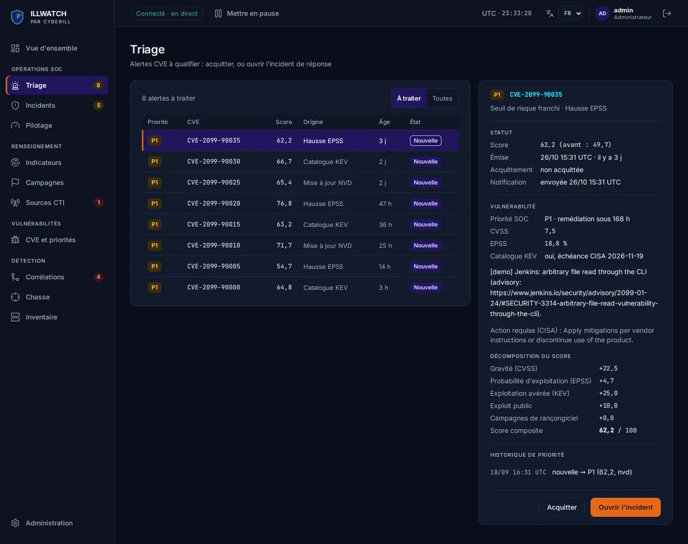

*Figure : l'écran Triage, la file des alertes et le détail d'une alerte.*

| Action | Dans l'application | En ligne de commande |
|---|---|---|
| Voir la file | *Triage* (à traiter, ou toutes) | `illwatch cves alerts` (`--all` pour toutes) |
| Comprendre le score | *Triage*, cliquer une alerte : décomposition et historique | `illwatch cves show CVE-2024-3400` |
| Acquitter | **Acquitter** | (application ou API) |
| Ouvrir l'incident | **Ouvrir l'incident** (un seul par alerte) | `illwatch incidents from-alert <id de l'alerte>` |

### 7.3 Lire les priorités des vulnérabilités

**Dans l'application** : écran **CVE et priorités**. Recherche par identifiant ou par produit
(« fortios », « log4j »), filtres par priorité et « Exploitées (KEV) ». La fiche d'une CVE
montre ses signaux, la décomposition de son score, son historique de priorité, ses alertes et ses
incidents, et permet d'**Ouvrir un incident pour cette CVE**.

**En ligne de commande** :

```bash
illwatch cves list --priority P0_CRITIQUE
illwatch cves list --kev --limit 50
illwatch cves list --search confluence --min-score 60
illwatch cves show CVE-2021-44228
```

### 7.4 Traiter les corrélations

**Dans l'application** : écran **Corrélations**. Chaque évènement dit *pourquoi* il existe (règle,
actif, produit, version, signaux), décompose son score, et propose trois actions :
**Acquitter**, **Ouvrir l'incident**, ou **Qualifier de faux positif** (l'évènement ne sera
plus rouvert, et l'IOC en cause passe en liste d'exclusion). **Corréler maintenant** lance une
passe sans attendre le worker.

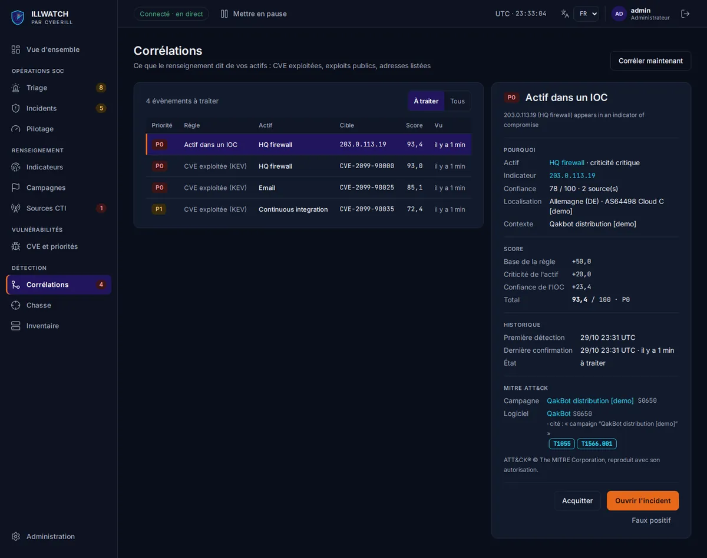

*Figure : l'écran Corrélations.*

**En ligne de commande** :

```bash
illwatch correlate run
illwatch correlate list            # évènements ouverts, les plus graves d'abord
illwatch correlate list --all      # y compris acquittés et clos
```

### 7.5 Conduire un incident

Un incident suit le cycle NIST SP 800-61 : **Nouveau, Analyse, Confinement, Éradication,
Récupération, Clôture**.

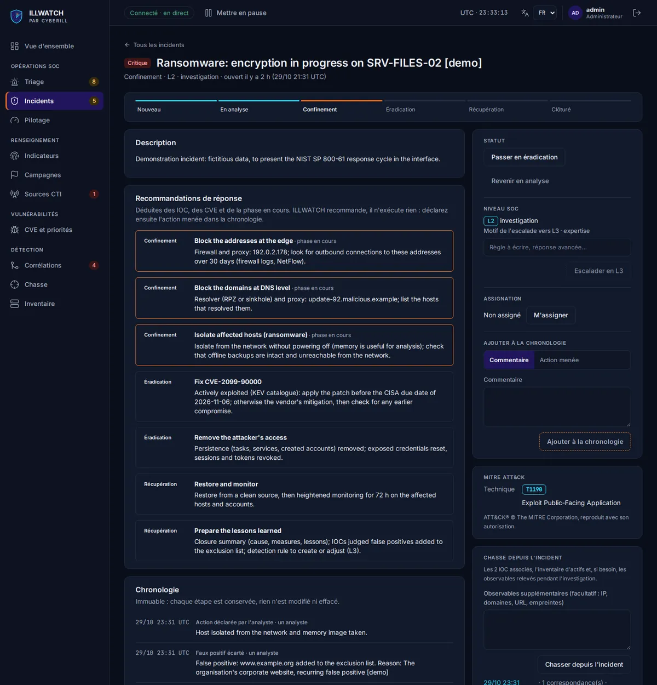

*Figure : la page d'investigation d'un incident.*

| Action | Dans l'application | En ligne de commande |
|---|---|---|
| Ouvrir un incident | *Incidents*, **Nouvel incident** ; ou depuis une alerte, une CVE, une corrélation | `illwatch incidents create --title "…" --severity HIGH` |
| S'assigner l'incident | page de l'incident, **M'assigner** | (application ou API) |
| Faire avancer le statut | **Passer en …** (note facultative ; résumé obligatoire pour clore) | `illwatch incidents move <ID> CONFINEMENT --note "Poste isolé"` |
| Revenir en analyse | **Revenir en analyse** | `illwatch incidents move <ID> ANALYSE` |
| Clore | **Passer en Clôture** avec le résumé : cause, mesures, enseignements | `illwatch incidents move <ID> CLOTURE --summary "…"` |
| Noter une action | *Type de note* : Commentaire ou Action menée | `illwatch incidents note <ID> "Règle de pare-feu ajoutée" --action` |
| Associer un IOC ou une CVE | **Associer un IOC** / **Associer une CVE** | (application ou API) |
| Escalader | **Escalader en L2** puis **L3**, motif obligatoire | `illwatch incidents escalate <ID> --reason "IOC confirmé"` |
| Chasser depuis l'incident | **Chasser depuis l'incident** | (application ou API) |
| Écarter un faux positif | sur un IOC associé, **Exclure (faux positif)** | `illwatch soc exclude <valeur> --reason "…"` |

La chronologie est **immuable** : la base refuse toute modification ou suppression d'un
évènement passé. Une fois l'incident clos, seuls les commentaires restent possibles.

### 7.6 Chasser les menaces

Une chasse confronte des **observables** (un export de pare-feu, de proxy ou d'EDR, la liste
d'un bulletin) ou toute la base aux six règles de détection.

**Dans l'application** : écran **Chasse**, **Nouvelle chasse** : collez les observables (une
valeur par ligne, 10 000 au plus), indiquez si besoin l'inventaire pour la règle des CVE
exploitables, cochez les règles, puis **Lancer la chasse**. Sans observable, la chasse porte sur
toute la base d'IOC actifs (bouton **Chasser sur toute la base**).

**En ligne de commande** :

```bash
illwatch hunt rules
illwatch hunt run --observables proxy.txt
illwatch hunt run --observables proxy.txt --asset FortiOS --rule RULE-06
illwatch hunt show <id de session>
```

Une chasse sur toute la base est aussi lancée **chaque jour** par le worker.

### 7.7 Consulter et qualifier les indicateurs (IOC)

**Dans l'application** : écran **Indicateurs**. Recherche d'une valeur (les formes défangées
comme `evil[.]com` sont acceptées), filtres par état, type, sévérité et source. La fiche montre la
confiance décomposée, la provenance de chaque source, l'enrichissement (pays, opérateur) et les
incidents liés. Actions : **Marquer comme faux positif**, **Soumettre des IOC** (un lot de
valeurs), **Exporter** (CSV, consigné au journal d'audit).

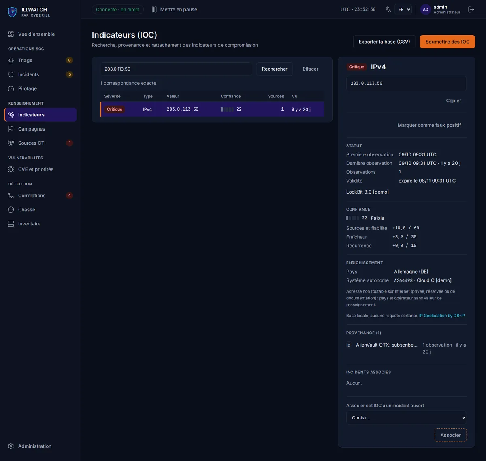

*Figure : la fiche d'un indicateur, avec sa confiance et son enrichissement.*

**En ligne de commande** :

```bash
illwatch enrich ip 203.0.113.50                         # pays et opérateur
illwatch soc exclude 203.0.113.7 --reason "Résolveur public de l'entreprise" --days 90
illwatch soc exclusions
illwatch dashboard export iocs --format csv -o iocs.csv
```

### 7.8 Regrouper par campagne

**Dans l'application** : écran **Campagnes**, **Nouvelle campagne** (nom, acteur ATT&CK
facultatif), puis **Rattacher de l'infrastructure** : les IOC dont la description contient un
texte (nom d'un pulse OTX, d'un rapport), ou une liste de valeurs.

**En ligne de commande** :

```bash
illwatch campaigns create "Distribution QakBot" --actor S0650
illwatch campaigns attach "Distribution QakBot" --contains "Qakbot"
illwatch campaigns list
```

### 7.9 Piloter le SOC

**Dans l'application** : écran **Pilotage** (7 ou 30 jours) : délai moyen de prise en charge
(MTTA) et de résolution (MTTR), délais cibles par sévérité et dépassements, incidents par niveau
L1, L2, L3, charge par analyste, ouverts et clos par jour, faux positifs écartés.

**En ligne de commande** : `illwatch soc metrics --days 30` et `illwatch dashboard show`.

### 7.10 Exporter et partager

| Besoin | Dans l'application | En ligne de commande |
|---|---|---|
| Export CSV ou JSON (IOC, CVE, incidents, alertes) | *Indicateurs*, **Exporter** | `illwatch dashboard export cves --format csv -o cves.csv` |
| Bundle STIX 2.1 | (API `GET /api/v1/stix/bundle`) | `illwatch stix export -o illwatch-stix.json` |
| Partage TAXII 2.1 vers un SIEM, OpenCTI ou MISP | créer un compte **Lecteur** dédié | `illwatch users create --username siem --role viewer --email …` |

Côté consommateur : découverte `https://<domaine>/taxii2/`, racine `…/taxii2/illwatch/`,
authentification Basic avec le compte lecteur. Les IOC exclus ne sont jamais partagés.

---

## 8. Administrer la plateforme

### 8.1 Comptes et sessions

| Besoin | Dans l'application (*Administration*, *Comptes*) | En ligne de commande |
|---|---|---|
| Changer un rôle | choisir le rôle (sessions ouvertes révoquées) | (application ou API) |
| Couper un accès immédiatement | **Désactiver le compte** | `illwatch users disable alice` |
| Vol de session suspecté | **Révoquer les sessions** | `illwatch users revoke-sessions alice` |
| Mot de passe oublié | **Réinitialiser le mot de passe** | `illwatch users set-password alice` |
| Réactiver | **Réactiver le compte** | `illwatch users enable alice` |

### 8.2 Journal d'audit

Toutes les connexions, refus d'accès, actions d'administration, exports, chasses et
modifications sont consignés **en ajout seul** (la base refuse modification et suppression).

**Dans l'application** : *Administration*, onglet **Journal d'audit**, filtres par famille
d'actions et par résultat.

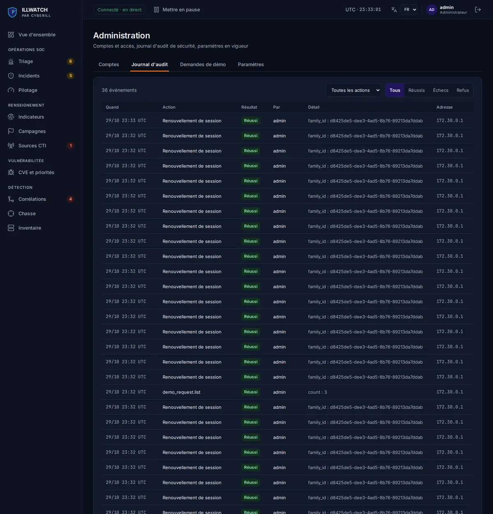

*Figure : le journal d'audit.*
 **En ligne de commande** :

```bash
illwatch audit list
illwatch audit list --action auth. --outcome FAILURE --since 24
```

À surveiller : rafales d'échecs de connexion (force brute), accès refusés répétés (compte qui
sonde ses droits), exports inhabituels (exfiltration).

### 8.3 Paramètres en vigueur et demandes de démonstration

*Administration*, onglet **Paramètres** : la configuration effective, sans aucun secret. Onglet
**Demandes de démo** : les demandes reçues par le formulaire du site de présentation, à marquer
*recontactée* ou *close* (`illwatch demo-requests list`).

---

## 9. Exploiter dans la durée

### 9.1 Sauvegarder

```bash
scripts/backup.sh                                   # ./backups, 14 sauvegardes vérifiées (SHA-256)
KEEP=30 scripts/backup.sh /srv/illwatch-backups     # autre dossier, 30 conservées
```

Planification quotidienne (`crontab -e`) :

```cron
17 2 * * * cd $HOME/cyberillsec-illwatch && scripts/backup.sh $HOME/illwatch-backups >> $HOME/illwatch-backup.log 2>&1
```

Restaurer (arrêter l'API et le worker avant) : `scripts/restore.sh <fichier.dump>` puis
`illwatch db upgrade`. Testez une restauration chaque mois sur une base jetable : une
sauvegarde jamais restaurée n'est pas une sauvegarde.

### 9.2 Mettre à jour

```bash
git pull --ff-only
source .venv/bin/activate
pip install -c constraints.txt -e ".[dev]"
scripts/backup.sh
illwatch db upgrade
./scripts/build-web.sh
# puis redémarrer l'API et le worker (tmux attach -t illwatch, Ctrl+C, relancer)
```

### 9.3 Surveiller

| Sonde | Réponse attendue |
|---|---|
| `curl -s localhost:8000/health` | toujours 200 (vivacité) |
| `curl -s localhost:8000/ready` | 200 si base joignable, schéma à jour et Redis présent ; 503 sinon |
| `curl -s localhost:8000/metrics \| grep '^illwatch_'` | métriques Prometheus |
| `illwatch status` | jalons, sources, fraîcheur EPSS |

Sur un serveur, Prometheus et Grafana suivent ces métriques (tableaux « Service » et « Collecte
et SOC ») et alertent si une source ou le worker s'arrête.

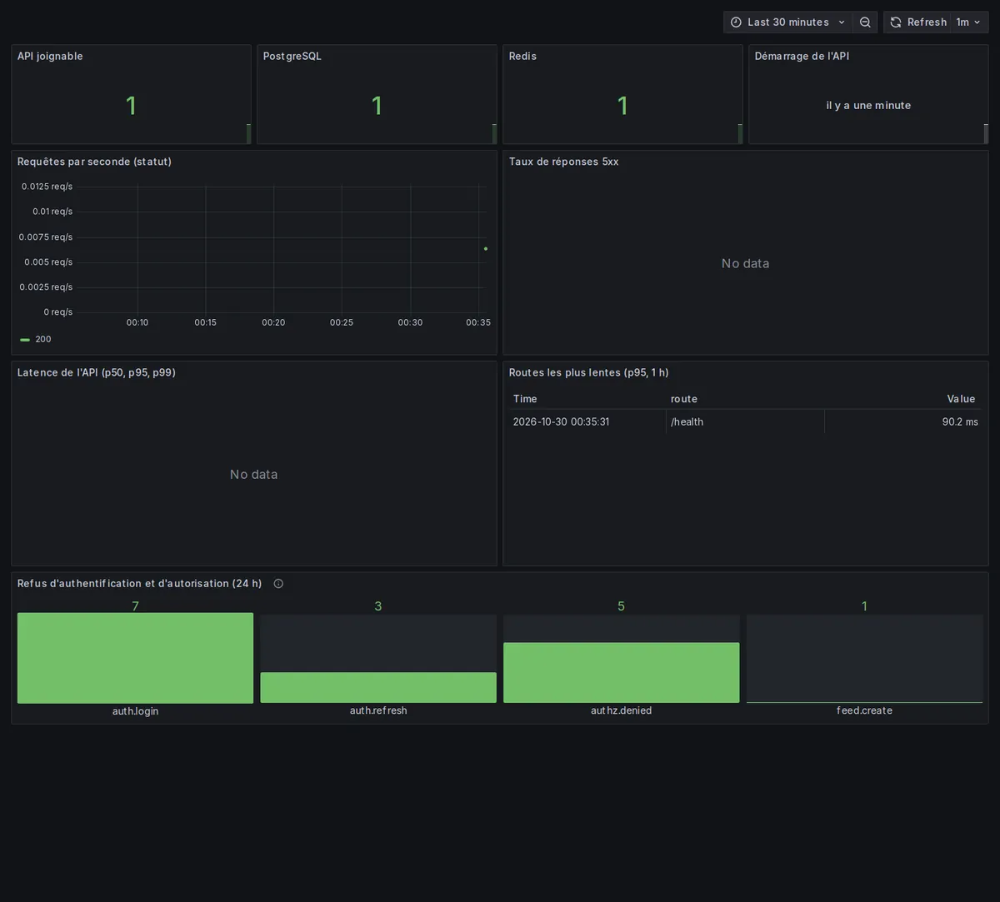

*Figure : le tableau Grafana « ILLWATCH : Service ».*

Le worker fait chaque jour l'entretien : purge des sessions expirées, purge du journal des
collectes au-delà de 90 jours, contrôle de fraîcheur d'EPSS (avertissement au-delà de 48 h).

### 9.4 Au redémarrage de l'ordinateur

PostgreSQL et Redis repartent seuls. L'API et le worker sont à relancer (section 2.7).

---

## 10. Passer sur un serveur

### 10.1 Répéter en local : la préproduction

```bash
./scripts/preprod-local.sh up       # pile de production complète, compte admin créé
./scripts/preprod-local.sh check    # HTTPS, en-têtes, droits, worker, sauvegarde puis restauration
./scripts/preprod-local.sh demo     # données fictives, si besoin d'une démonstration
./scripts/preprod-local.sh down     # arrêt, données conservées
```

Adresse : **https://illwatch.localhost:8443** (certificat interne de Caddy, à accepter). Cette
pile tourne à côté de l'installation du poste, avec ses propres conteneurs et volumes.

### 10.2 Serveur européen (VPS)

Prérequis : un VPS dans l'Union européenne (Debian 12 ou 13, Ubuntu 24.04 ; 2 cœurs, 4 Go,
40 Go), un nom de domaine dont l'enregistrement A pointe vers lui, les ports 80 et 443 ouverts.

```bash
curl -fsSLO https://raw.githubusercontent.com/GodwillFoka/cyberillsec-illwatch/main/scripts/deploy-vps.sh
sudo bash deploy-vps.sh install illwatch.votre-domaine.eu vous@exemple.eu
sudo bash /opt/illwatch/scripts/deploy-vps.sh check
```

L'installation pose Docker, le pare-feu, les secrets (fichier `.env` en 600), le certificat
Let's Encrypt, le compte `admin` (mot de passe affiché **une seule fois**), la sauvegarde
quotidienne, Prometheus et Grafana. Mise à jour : `deploy-vps.sh update`.

---

## 11. Dépannage

| Symptôme | Cause | Correction |
|---|---|---|
| `illwatch: command not found` | environnement Python non activé | `source .venv/bin/activate` |
| `connection refused` sur le port 5433 | conteneurs arrêtés | `docker compose up -d postgres redis` |
| `password authentication failed for user "illwatch_app"` | rôle applicatif absent (ancien volume) | `ILLWATCH_APP_DB_PASSWORD=illwatch-app-dev illwatch db app-role illwatch_app --create` puis `illwatch db upgrade` |
| `permission denied for table …` | `alembic upgrade` lancé seul | `illwatch db upgrade` |
| `/ready` en 503, `"schema": "fail"` | migration oubliée | `illwatch db upgrade` |
| l'adresse du site n'affiche que l'API | interface non construite | `./scripts/build-web.sh`, puis redémarrer uvicorn |
| erreur 429 à la connexion | 5 échecs en 15 minutes | attendre 15 minutes |
| aucune CVE en P0 | EPSS absent ou périmé | `illwatch cves sync`, vérifier que le worker tourne |
| erreur 429 de NVD | pas de clé NVD | renseigner `NVD_API_KEY` |
| une source reste *dégradée* | hôte injoignable, clé absente, format changé | `illwatch feeds probe "<nom>"` |
| import d'inventaire refusé | ligne invalide | lire le motif dans l'aperçu, corriger la ligne |
| aucune corrélation | inventaire vide ou produits mal nommés | section 5 |

---

## 12. Aide-mémoire

| Je veux… | Commande |
|---|---|
| activer l'environnement | `cd ~/cyberillsec-illwatch && source .venv/bin/activate` |
| démarrer la base | `docker compose up -d postgres redis` |
| lancer l'API / le worker | `uvicorn illwatch.app.main:app --host 127.0.0.1 --port 8000` / `illwatch feeds worker` |
| vérifier l'état | `illwatch status` et `curl -s localhost:8000/ready` |
| collecter maintenant | `illwatch feeds fetch-all --force` |
| synchroniser les CVE | `illwatch cves sync` |
| voir les P0 | `illwatch cves list --priority P0_CRITIQUE` |
| détailler un score | `illwatch cves show CVE-2021-44228` |
| modèle d'inventaire | `illwatch assets template` |
| importer l'inventaire | `illwatch assets import inventaire.xlsx --dry-run`, puis sans `--dry-run` |
| corréler maintenant | `illwatch correlate run` |
| chasser dans un export | `illwatch hunt run --observables proxy.txt` |
| écarter un faux positif | `illwatch soc exclude <valeur> --reason "…"` |
| lire l'audit | `illwatch audit list --action auth. --outcome FAILURE --since 24` |
| sauvegarder | `scripts/backup.sh` |
| mettre à jour | `git pull`, `pip install …`, `illwatch db upgrade`, `./scripts/build-web.sh` |
