# Manuel fonctionnel : acteurs, fonctionnalités et actions

[:octicons-download-16: Télécharger le PDF v2.0](pdf/ILLWATCH_Manuel_fonctionnel_v2.pdf){ .md-button } [:material-home: Toute la documentation](README.md){ .md-button }

**Version 2.0, octobre 2026** · ILLWATCH `0.2.0.dev0`

Un outil de sécurité auquel on ne fait pas confiance finit toujours ignoré. Pour lui faire
confiance, il faut le comprendre. Ce manuel ouvre donc le capot : **ce que fait** ILLWATCH,
**qui** a le droit de faire quoi, et **comment** chaque résultat est obtenu, formules comprises.
Rien n'y est magique, tout s'y explique. Pour installer la plateforme ou retrouver les gestes du
quotidien, le [Guide d'installation et d'exploitation](GUIDE_INSTALLATION.md) est votre compagnon.

Chaque fonctionnalité suit le même fil, pour que vous trouviez vite ce que vous cherchez :
**à quoi elle sert**, **comment elle fonctionne**, **comment l'utiliser** (dans l'application, en
ligne de commande, par l'API) et **comment lire le résultat**.

## Sommaire

1. [ILLWATCH en un coup d'œil](#1-illwatch-en-un-coup-dil)
2. [Les acteurs et leurs droits](#2-les-acteurs-et-leurs-droits)
3. [Le renseignement : sources et indicateurs](#3-le-renseignement-sources-et-indicateurs)
4. [Les vulnérabilités : score et priorités](#4-les-vulnerabilites-score-et-priorites)
5. [Corrélation : le renseignement rapporté à vos actifs](#5-correlation-le-renseignement-rapporte-a-vos-actifs)
6. [Triage et incidents](#6-triage-et-incidents)
7. [Chasse aux menaces](#7-chasse-aux-menaces)
8. [Contexte adverse : MITRE ATT&CK et campagnes](#8-contexte-adverse-mitre-attck-et-campagnes)
9. [Partage et exports](#9-partage-et-exports)
10. [Pilotage et tableau de bord](#10-pilotage-et-tableau-de-bord)
11. [Administration, audit et sécurité](#11-administration-audit-et-securite)
12. [Ce que la plateforme fait seule](#12-ce-que-la-plateforme-fait-seule)
13. [Parcours types](#13-parcours-types)
14. [Glossaire](#14-glossaire)

---

## 1. ILLWATCH en un coup d'œil

Un analyste de sécurité passe trop de temps à des tâches de machine : collecter des flux,
dédoublonner des listes, noter des vulnérabilités, croiser tout cela avec un inventaire. ILLWATCH
prend ce travail à sa charge pour que l'analyste se consacre à ce que lui seul sait faire :
**décider**. Quoi corriger d'abord, quoi bloquer, quel incident ouvrir, et garder la preuve de ce
qui a été fait.

Concrètement, voici les questions que se pose une équipe, et la réponse que lui apporte ILLWATCH :

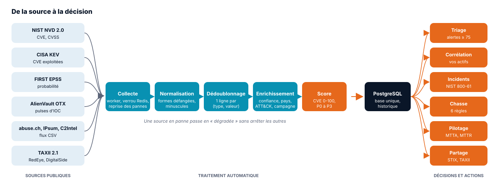

| Question de l'équipe | Réponse d'ILLWATCH | Où |
|---|---|---|
| Quelle vulnérabilité corriger d'abord ? | score de 0 à 100 et priorité P0 à P3, fondés sur l'exploitation réelle | CVE et priorités, Triage |
| Est-ce que ça nous concerne ? | corrélation avec l'inventaire : produits, versions, adresses, domaines | Corrélations |
| Cette adresse est-elle malveillante ? | base d'IOC dédoublonnée, avec confiance, provenance et contexte | Indicateurs |
| Sommes-nous déjà touchés ? | chasse sur un export de journaux ou sur toute la base | Chasse |
| Où en est la réponse ? | incidents au cycle NIST, niveaux L1 à L3, délais cibles | Incidents, Pilotage |
| Pouvons-nous le prouver ? | chronologies et journal d'audit immuables | Incidents, Administration |

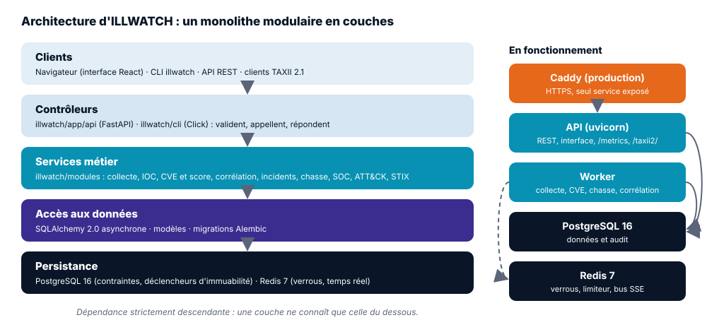

---

## 2. Les acteurs et leurs droits

Autour d'ILLWATCH gravitent des personnes, qui décident, et des automates, qui travaillent sans
relâche. Chacun a sa place, et ses droits sont bornés au strict nécessaire.

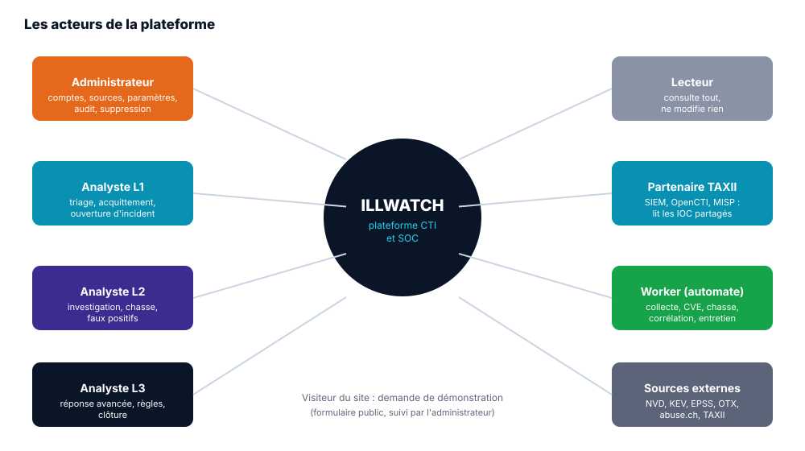

### 2.1 Les acteurs humains

| Acteur | Rôle dans ILLWATCH | Missions |
|---|---|---|
| **Administrateur** | ADMIN | gère les comptes, les sources, les paramètres ; supprime ; lit le journal d'audit ; suit les demandes de démonstration |
| **Analyste** | ANALYST | trie les alertes, conduit les incidents, chasse, déclare l'inventaire, écarte les faux positifs, crée les campagnes |
| **Lecteur** | VIEWER | consulte tous les écrans sans rien modifier (direction, auditeur, stagiaire) |
| **Partenaire TAXII** | VIEWER dédié | un SIEM, OpenCTI ou MISP qui lit les IOC partagés par le serveur TAXII |
| **Visiteur du site** | aucun compte | demande une démonstration par le formulaire public du site de présentation |

!!! note "Rôles et niveaux SOC : ne pas confondre"
    Le **rôle** (administrateur, analyste, lecteur) dit ce qu'une **personne** a le droit de faire.
    Le **niveau SOC** (L1, L2, L3) dit où en est un **incident** dans l'escalade. Les deux sont
    indépendants : un même analyste peut traiter un incident en L1 le matin et un autre en L3
    l'après-midi.

### 2.2 Les acteurs automatiques

| Acteur | Ce qu'il fait |
|---|---|
| **Worker** | collecte les sources, synchronise les CVE toutes les 6 h, corrèle chaque heure, chasse et fait l'entretien chaque jour |
| **Sources externes** | NIST NVD, CISA KEV, FIRST EPSS, AlienVault OTX, abuse.ch, IPsum, C2IntelFeeds, serveurs TAXII (RedEye, DigitalSide), MITRE ATT&CK, DB-IP |
| **Webhook d'alerte** | reçoit chaque alerte CVE (Slack, Mattermost) si `ALERT_WEBHOOK_URL` est renseigné |
| **Prometheus et Grafana** | lisent `/metrics` et alertent si une source ou le worker s'arrête |

### 2.3 Qui peut faire quoi

Cette matrice n'a pas été écrite de mémoire : elle reprend les contrôles réellement appliqués par
l'API. Toute tentative refusée laisse une trace au journal d'audit, sous `authz.denied`.
« App » signifie dans l'application ; « CLI », en ligne de commande. Dans ce dernier cas,
l'opérateur du serveur agit sans compte, et ses actions sont attribuées à l'utilisateur système.

| Action | Admin | Analyste | Lecteur | Méthodes |
|---|:-:|:-:|:-:|---|
| Consulter tous les écrans et données | ✅ | ✅ | ✅ | App, API |
| Créer, modifier, désactiver un compte ; réinitialiser un mot de passe | ✅ | | | App, CLI, API |
| Lire le journal d'audit et les paramètres | ✅ | | | App, CLI, API |
| Ajouter, régler, suspendre, supprimer une source | ✅ | | | App, CLI, API |
| Déclarer, modifier, importer, exporter l'inventaire | ✅ | ✅ | | App, CLI, API |
| Supprimer un actif | ✅ | | | App, CLI, API |
| Télécharger le modèle d'inventaire | ✅ | ✅ | ✅ | App, CLI, API |
| Acquitter une alerte CVE ; ouvrir l'incident de réponse | ✅ | ✅ | | App, CLI, API |
| Lancer une corrélation ; acquitter un évènement ; le qualifier de faux positif | ✅ | ✅ | | App, CLI, API |
| Ouvrir, assigner, faire avancer, escalader un incident ; ajouter une note | ✅ | ✅ | | App, CLI, API |
| Associer un IOC ou une CVE à un incident ; chasser depuis l'incident | ✅ | ✅ | | App, API |
| Lancer une chasse | ✅ | ✅ | | App, CLI, API |
| Soumettre un lot d'IOC | ✅ | ✅ | | App, API |
| Mettre une valeur en liste d'exclusion (faux positif) | ✅ | ✅ | | App, CLI, API |
| Retirer une exclusion | ✅ | | | App, API |
| Créer, modifier une campagne ; y rattacher des IOC | ✅ | ✅ | | App, CLI, API |
| Supprimer une campagne | ✅ | | | App, API |
| Exporter CSV, JSON, STIX 2.1 ; lire le serveur TAXII | ✅ | ✅ | ✅ | App, CLI, API |
| Suivre les demandes de démonstration | ✅ | | | App, CLI, API |

---

## 3. Le renseignement : sources et indicateurs

### 3.1 Les sources

**À quoi elles servent.** À nourrir la base d'indicateurs de compromission (IOC) avec du
renseignement public et gratuit. Vous n'avez pas besoin d'un abonnement coûteux pour commencer.

**Comment ça fonctionne.** Toutes les minutes, le worker se réveille et collecte chaque source
dont l'intervalle est écoulé. Un verrou Redis garantit que deux instances ne collectent jamais la
même source en même temps. Cinq formats sont pris en charge : CSV, JSON, STIX 2.1, TAXII 2.1 et
l'API AlienVault OTX. Chaque collecte laisse une ligne au journal des collectes (volumes, durée,
erreur éventuelle). Quand une source échoue, elle passe en *dégradée* et ses essais s'espacent
(1, 2, 4 minutes…) ; pendant ce temps, les autres continuent comme si de rien n'était.

| Source de référence | Format | Contenu | Fiabilité par défaut |
|---|---|---|---|
| abuse.ch URLhaus | CSV | URL malveillantes récentes (clé abuse.ch) | B |
| abuse.ch Feodo Tracker | CSV | serveurs de commande de botnets | B |
| C2IntelFeeds (adresses, domaines) | CSV | serveurs de commande des 30 derniers jours | C |
| IPsum | CSV | adresses présentes dans au moins 5 listes noires | B |
| RedEye | TAXII 2.1 | indicateurs STIX (jeton gratuit) | C |
| DigitalSide (URL, réseau) | CSV, TAXII 2.1 | URL et IOC réseau ; désactivées par défaut (serveur souvent hors ligne) | C |
| AlienVault OTX | OTX | pulses de la communauté (clé gratuite) | D |

**Sécurité.** Un outil de sécurité ne doit pas devenir une porte d'entrée. Une source doit donc
être publique et en HTTPS, et avant chaque requête, ILLWATCH vérifie que l'adresse résolue est
bien publique (protection SSRF). La taille des réponses est plafonnée. Quant aux clés d'accès,
elles ne sont jamais stockées en base et ne partent que vers leur hôte officiel.

**Utiliser.** Écran **Sources CTI** (voir le [guide, section 4](GUIDE_INSTALLATION.md#4-brancher-les-sources-de-renseignement)) ;
`illwatch feeds list | probe | add | enable | disable | fetch | fetch-all` ; `/api/v1/feeds`.

**Lire le résultat.** *Saine* : dernière collecte réussie. *Dégradée* : la dernière a échoué
(le motif est dans le détail). *En attente* : jamais collectée. *Suspendue* : désactivée par un
administrateur.

### 3.2 Le cycle de vie d'un IOC

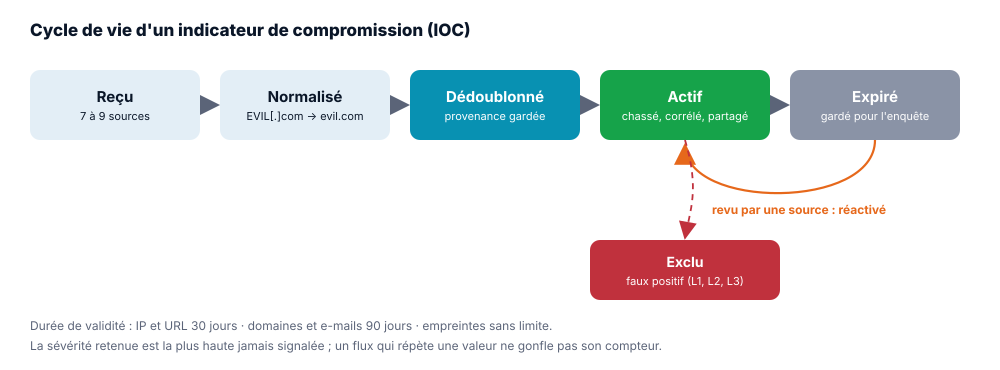

**Comment ça fonctionne.** Le même indicateur arrive souvent de plusieurs sources, écrit de
plusieurs façons. Avant d'entrer en base, il passe par cinq étapes :

1. **Normalisation** : les formes défangées sont refaites (`hxxps://evil[.]com` devient
   `https://evil.com`), domaines, e-mails et empreintes passent en minuscules, les adresses IP
   sont canonisées. Types reconnus : IPv4, IPv6, plage réseau (CIDR), domaine, URL, e-mail,
   empreintes MD5, SHA-1, SHA-256.
2. **Dédoublonnage** : un IOC est identifié par le couple (type, valeur normalisée) ; la base
   garantit l'unicité. La **provenance** de chaque source est gardée (première et dernière
   observation, nombre d'observations par source).
3. **Sévérité** : la plus haute jamais signalée par une source.
4. **Expiration** : adresses et URL 30 jours après la dernière observation, domaines et e-mails
   90 jours, empreintes jamais. Un IOC expiré est **conservé** pour l'enquête, mais n'est plus
   actif ; une nouvelle observation le réactive.
5. **Exclusion** : un IOC qualifié de faux positif reste en base, mais n'est plus ni compté, ni
   chassé, ni corrélé, ni partagé.

Et quand une valeur est invalide, elle est **refusée et listée**, jamais ignorée en silence :
vous savez toujours ce qui n'est pas entré.

### 3.3 La confiance d'un IOC

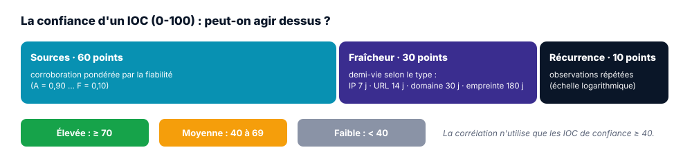

**À quoi elle sert.** À répondre à une question que tout analyste se pose avant de bloquer :
« puis-je me fier à cet indicateur ? ». C'est une autre question que sa gravité. Le bon sens le
dit : une adresse confirmée hier par trois sources fiables pèse plus qu'une adresse signalée une
seule fois il y a trois semaines. La confiance traduit ce bon sens en chiffre.

**Comment ça se calcule (0 à 100).**

- **Sources, 60 points** : probabilité qu'au moins une source dise vrai, `1 − Π(1 − wᵢ)`, avec un
  poids par fiabilité (A 0,90, B 0,75, C 0,50, D 0,30, E 0,15, F 0,10). Deux sources « C » valent
  plus qu'une seule.
- **Fraîcheur, 30 points** : décroissance exponentielle depuis la dernière observation, avec une
  demi-vie selon le type (adresse 7 jours, URL 14, domaine 30, e-mail 60, empreinte 180).
- **Récurrence, 10 points** : observations répétées, en échelle logarithmique.

Un IOC soumis à la main compte comme une source de fiabilité C.

**Lire le résultat.** Élevée (70 et plus), moyenne (40 à 69), faible (moins de 40). La
corrélation n'utilise que les IOC de confiance 40 et plus (`CORRELATION_MIN_CONFIDENCE`).

### 3.4 L'enrichissement des adresses IP

D'où vient cette adresse, et qui l'opère ? La fiche affiche son **pays** et son **système
autonome** (opérateur), lus dans la base DB-IP Lite importée sur votre machine. Ce détail compte :
consulter une adresse ne déclenche **aucune requête sortante**, donc personne à l'extérieur ne
sait sur quoi vous enquêtez. Une adresse privée, réservée ou de documentation est signalée comme
non routable. Après un premier `illwatch enrich update`, la base se met à jour seule chaque mois.

### 3.5 Utiliser l'écran Indicateurs

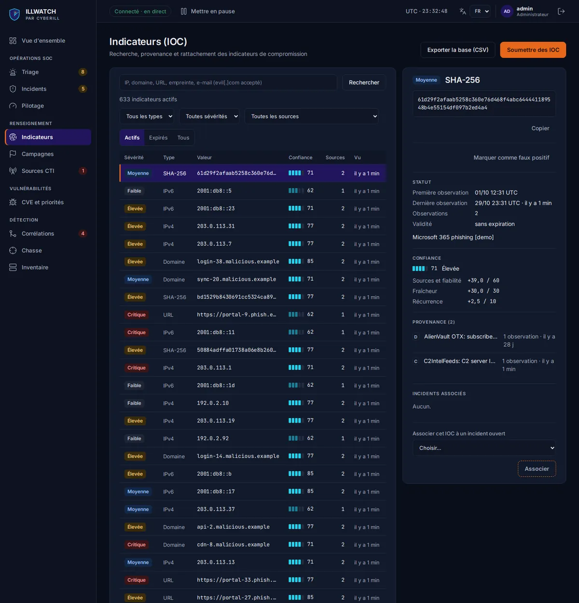

| Action | Dans l'application | En ligne de commande ou API |
|---|---|---|
| Chercher une valeur | champ « Valeur recherchée » (`evil[.]com` accepté) | `GET /api/v1/indicators?q=…` |
| Filtrer | état (actifs, expirés, tous), type, sévérité minimale, source | idem, paramètres de requête |
| Lire la fiche | confiance décomposée, provenance, enrichissement, incidents liés | `GET /api/v1/indicators/{id}` |
| Soumettre un lot | **Soumettre des IOC** (une valeur par ligne) | `POST /api/v1/indicators` |
| Écarter un faux positif | **Marquer comme faux positif**, avec le motif | `illwatch soc exclude <valeur> --reason "…"` |
| Exporter | **Exporter** (CSV, audité) | `illwatch dashboard export iocs --format csv -o iocs.csv` |

---

## 4. Les vulnérabilités : score et priorités

### 4.1 À quoi sert le score

Des dizaines de milliers de vulnérabilités (CVE) sont publiées chaque année, et aucune équipe ne
peut tout corriger. La bonne nouvelle, c'est que la plupart ne seront jamais exploitées. Le score
vous dit **laquelle corriger d'abord**, en regardant ce que font réellement les attaquants plutôt
que la seule gravité théorique.

### 4.2 Comment le score se calcule

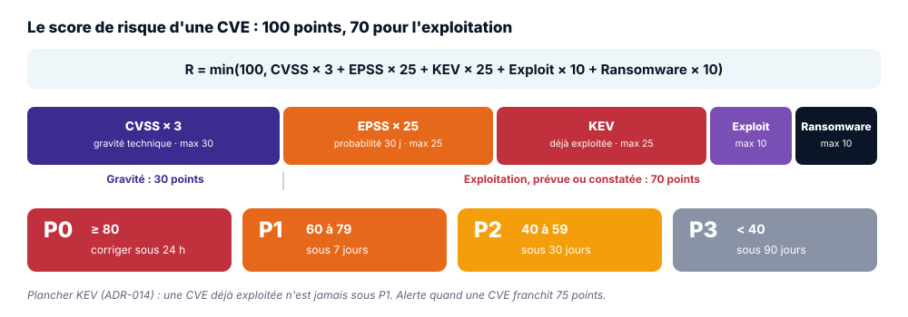

`R = min(100, CVSS × 3 + EPSS × 25 + KEV × 25 + Exploit × 10 + Ransomware × 10)`

| Facteur | Source | Valeur | Points |
|---|---|---|---|
| **CVSS** : gravité technique, de 0 à 10 | NIST NVD | note × 3 | 0 à 30 |
| **EPSS** : probabilité d'exploitation dans les 30 jours, de 0 à 1 | FIRST | probabilité × 25 | 0 à 25 |
| **KEV** : déjà exploitée dans la nature | CISA | 25 si présente | 0 ou 25 |
| **Exploit public** | référence NVD étiquetée « Exploit » | 10 si présent | 0 ou 10 |
| **Ransomware** : utilisée par des rançongiciels | CISA KEV | 10 si connu | 0 ou 10 |

Les poids font exactement 100 au total : la borne `min(100, …)` est un garde-fou, jamais un
écrêtage. Le parti pris est assumé : **30 points pour la gravité, 70 pour l'exploitation**, qu'elle
soit prévue (EPSS) ou déjà constatée (KEV, exploit, rançongiciel). Une faille moyenne que les
attaquants utilisent aujourd'hui passe avant une faille spectaculaire que personne n'exploite.
Ces poids viennent du cahier des charges et ont été arbitrés dans l'ADR-001.

### 4.3 Les priorités et leurs délais

| Priorité | Score | Délai de remédiation | Sens |
|---|---|---|---|
| **P0** | 80 et plus | 24 heures | critique : en pratique, une faille déjà exploitée et très probable |
| **P1** | 60 à 79 | 7 jours | haute |
| **P2** | 40 à 59 | 30 jours | à planifier |
| **P3** | moins de 40 | 90 jours | maintenance standard |

**Plancher KEV (ADR-014).** Une CVE du catalogue KEV ne descend jamais sous P1, quoi que dise la
formule. La raison est simple : une faille déjà exploitée ne peut pas relever de la maintenance
standard. La règle rejoint la directive CISA BOD 22-01. Et si EPSS est momentanément
indisponible, ILLWATCH garde la dernière valeur connue ; au-delà de 48 heures, `illwatch status`
vous le signale.

Quelques exemples pour voir la formule à l'œuvre :

| Exemple | CVSS | EPSS | KEV | Exploit | Rançon | Score | Priorité |
|---|---|---|---|---|---|---|---|
| Log4Shell | 30 | 23,5 | 25 | 10 | 10 | 98,5 | P0 |
| CVE KEV, CVSS 9,8, EPSS 0,05 | 29,4 | 1,3 | 25 | 0 | 0 | 55,7 | P1 (plancher KEV) |
| Hors KEV, CVSS 7,5, EPSS 0,90, exploit | 22,5 | 22,5 | 0 | 10 | 0 | 55 | P2 |
| Hors KEV, CVSS 9,8, EPSS 0,02 | 29,4 | 0,5 | 0 | 0 | 0 | 29,9 | P3 |

### 4.4 Ce que donne le tri sur données réelles

Sur les 26 416 CVE du poste de test, le tri ne laisse qu'une petite part à traiter en priorité :
c'est tout l'intérêt de la méthode.

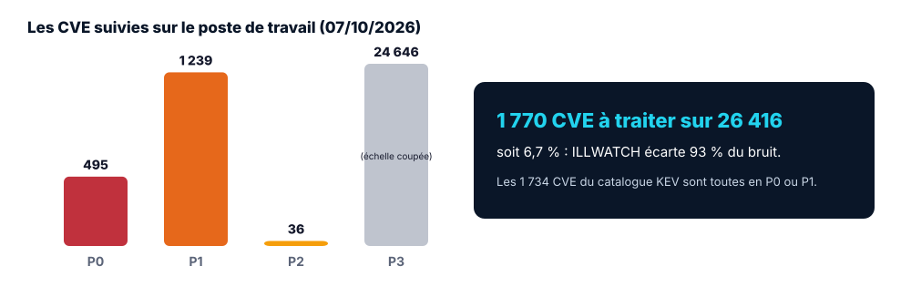

### 4.5 Les alertes

Une **alerte** part quand le score d'une CVE franchit **75** vers le haut
(`RISK_ALERT_THRESHOLD`), donc avant même son passage en P0 : vous êtes prévenu tôt. Elle est
enregistrée, journalisée, puis envoyée au webhook (5 tentatives au plus). La **première
synchronisation**, elle, sert de ligne de base et n'alerte pas. C'est un choix délibéré : une
équipe qui reçoit 400 alertes le premier jour apprend surtout à les ignorer. Chaque changement de
priorité est historisé, avec l'ancien et le nouveau score.

### 4.6 Utiliser

| Action | Dans l'application | En ligne de commande ou API |
|---|---|---|
| Liste par risque | **CVE et priorités** : recherche, priorité, « Exploitées (KEV) » | `illwatch cves list --priority P0_CRITIQUE` |
| Comprendre un score | fiche : signaux, décomposition, historique, action requise par la CISA | `illwatch cves show CVE-…`, `GET /api/v1/cves/{id}` |
| Ouvrir un incident | **Ouvrir un incident pour cette CVE** | `illwatch incidents from-alert <id>` |
| Synchroniser | (automatique, toutes les 6 h) | `illwatch cves sync [--only kev\|nvd\|epss]` |
| Travailler hors ligne | | `illwatch cves import CVE-2024.json.xz --only-known` |

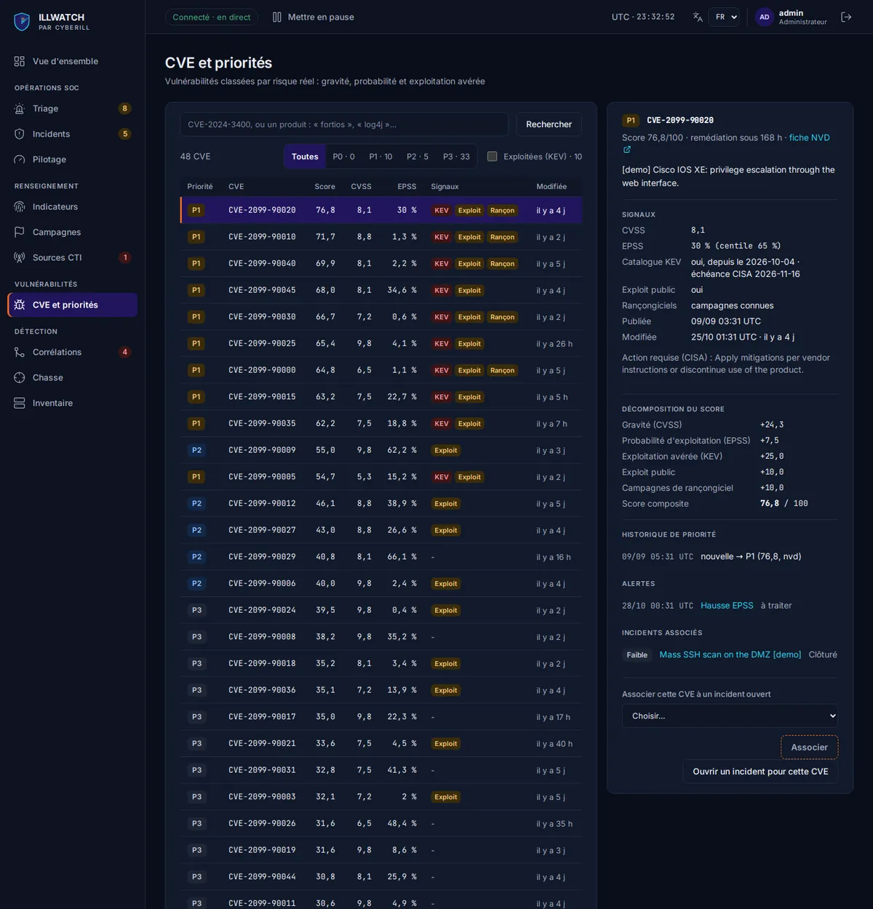

---

## 5. Corrélation : le renseignement rapporté à vos actifs

### 5.1 À quoi elle sert

Savoir qu'une CVE critique existe ne vous dit pas quoi faire lundi matin. Savoir que **votre
pare-feu du siège** est touché par une CVE exploitée, si. La corrélation fait ce chemin pour vous :
c'est elle qui transforme une base de renseignement en outil de décision pour votre organisation.

### 5.2 Comment elle fonctionne

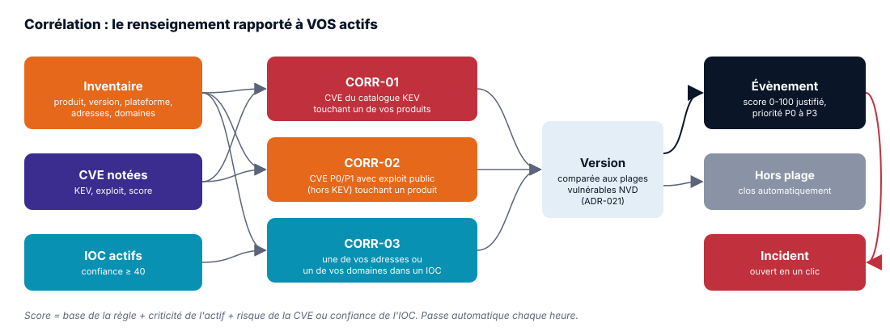

| Règle | Déclencheur | Base | Technique ATT&CK |
|---|---|---|---|
| **CORR-01** | une CVE du catalogue KEV touche un produit de l'inventaire | 60 | exploitation d'une application exposée |
| **CORR-02** | une CVE P0 ou P1 avec exploit public (hors KEV) touche un produit | 45 | idem |
| **CORR-03** | une de vos adresses ou un de vos domaines figure dans un IOC actif de confiance 40 et plus | 50 | - |

**Score de l'évènement (0 à 100)** = base de la règle + criticité de l'actif (faible 0, moyenne
5, élevée 12, critique 20) + signal (score de la CVE × 0,2, ou confiance de l'IOC × 0,3). La
priorité suit la même grille que les CVE.

*Exemple* : une CVE KEV de score 70 sur un actif de criticité élevée donne 60 + 12 + 14 = 86,
donc P0.

**Comparaison des versions (ADR-021).** C'est elle qui fait la différence entre un outil bavard
et un outil utile. Quand l'actif a une version, ILLWATCH la compare aux plages vulnérables
publiées par la NVD : hors plage, l'évènement est clos automatiquement ; sur une autre plateforme
que celle de l'actif, il est écarté. Les données réelles l'ont montré : sans comparaison des
versions, la première passe a produit 38 évènements, dont aucun vrai positif. Avec elle, 37 ont été
clos automatiquement et le dernier requalifié.

**Cycle de l'évènement.** Un évènement est unique par règle et par couple (actif, CVE ou IOC) :
vous ne le verrez pas en double. Une nouvelle passe le met à jour. Si vous l'avez acquitté, il
revient seulement s'il monte d'un cran de priorité. Qualifié de faux positif, il ne revient
jamais.

### 5.3 Utiliser

| Action | Dans l'application | En ligne de commande ou API |
|---|---|---|
| Déclarer l'inventaire | **Inventaire** : **Importer un fichier** (Excel, CSV) ou **Nouvel actif** | `illwatch assets template`, `assets import`, `assets add` |
| Lancer une passe | **Corréler maintenant** (sinon chaque heure) | `illwatch correlate run` |
| Lire les évènements | **Corrélations** : à traiter ou tous, filtre par actif | `illwatch correlate list [--all]` |
| Acquitter | **Acquitter** | `POST /api/v1/correlations/{id}/ack` |
| Ouvrir l'incident | **Ouvrir l'incident** (reprend la CVE ou l'IOC) | `POST /api/v1/correlations/{id}/incident` |
| Écarter | **Qualifier de faux positif**, motif obligatoire | `POST /api/v1/correlations/{id}/false-positive` |
| Mesurer la qualité | | `illwatch correlate evaluate` (jeu figé, aucune écriture) |

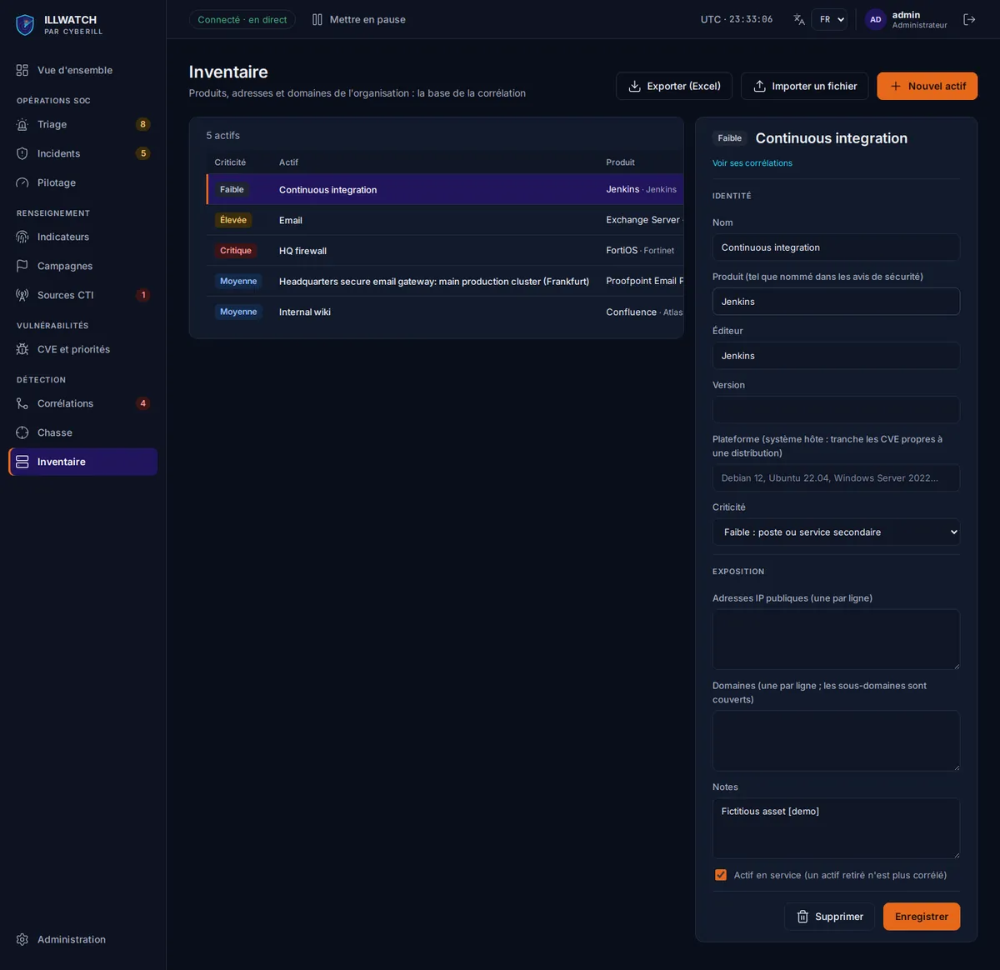

### 5.4 Lire le résultat

Le détail d'un évènement répond d'abord à la question **pourquoi**, parce qu'on n'agit bien que
sur ce qu'on comprend : la règle, l'actif et sa criticité, le produit reconnu, la version et la
plateforme, les signaux (KEV, échéance CISA, exploit), la confiance et la localisation de l'IOC.
Viennent ensuite la décomposition du score et l'historique (première détection, dernière
confirmation).

---

## 6. Triage et incidents

### 6.1 Le triage des alertes

**À quoi il sert.** À trancher, pour chaque alerte CVE : en prendre acte (**acquitter**) ou y
répondre (**ouvrir l'incident**). L'écran **Triage** range la file par priorité, puis par
ancienneté, pour que le plus urgent soit toujours en haut. Le panneau d'une alerte vous donne de
quoi décider : ce qui l'a déclenchée (catalogue KEV, hausse d'EPSS, mise à jour NVD), le score
avant et après, l'état de la notification, la vulnérabilité et la décomposition du score.

### 6.2 Le cycle d'un incident

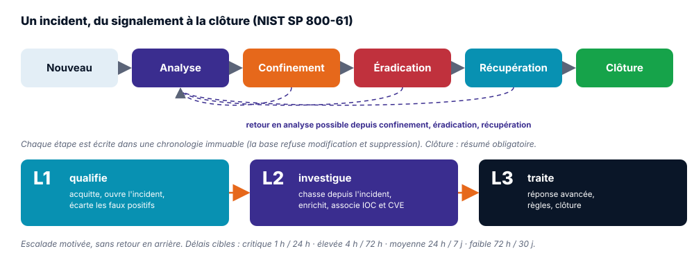

**Comment ça fonctionne.** Un incident traverse six états, ceux du NIST SP 800-61 : *Nouveau*,
*Analyse*, *Confinement*, *Éradication*, *Récupération*, *Clôture*. On avance d'un état à la
fois, sans brûler d'étape. La réalité n'étant pas toujours linéaire, un retour en *Analyse* reste
possible depuis le confinement, l'éradication et la récupération. Pour clore, il faut écrire un
résumé (cause, mesures, enseignements) : c'est ce qui permet d'apprendre de chaque incident. La
machine d'état est testée à 100 %.

**Chronologie immuable.** Tout ce qui arrive à l'incident est écrit dans sa chronologie :
ouverture, changement de statut, assignation, commentaire, action menée, IOC ou CVE associé,
escalade, chasse, exclusion. Des déclencheurs PostgreSQL refusent toute modification, suppression
ou troncature. Le jour où un régulateur ou un auditeur vous demande ce qui s'est passé, vous avez
une preuve recevable au sens de NIS 2 et de DORA.

**Niveaux SOC (ADR-022).** Chaque niveau a son métier. *L1 qualifie* (acquitte, ouvre, écarte les
faux positifs), *L2 investigue* (chasse depuis l'incident, enrichit, associe), *L3 traite*
(réponse avancée, règles, clôture). Toute escalade doit être motivée, et on ne redescend pas.

**Recommandations de réponse.** À partir des IOC, des CVE et de la phase en cours, ILLWATCH
propose les gestes que le NIST recommande pour cette phase. Il suggère, il ne décide pas : c'est
l'analyste qui choisit, puis déclare ce qu'il a fait (« Action menée »).

**Délais cibles.** Plus l'incident est grave, plus l'horloge tourne vite :

| Sévérité | Prise en charge | Résolution |
|---|---|---|
| Critique | 1 heure | 24 heures |
| Élevée | 4 heures | 72 heures |
| Moyenne | 24 heures | 7 jours |
| Faible | 72 heures | 30 jours |

L'horloge de **prise en charge** s'arrête au premier geste d'un analyste : une assignation, un
changement de statut, une escalade ou une note.

### 6.3 Utiliser

Chaque geste, dans l'application comme en ligne de commande, est décrit pas à pas dans le
[guide, section 7.5](GUIDE_INSTALLATION.md#75-conduire-un-incident).

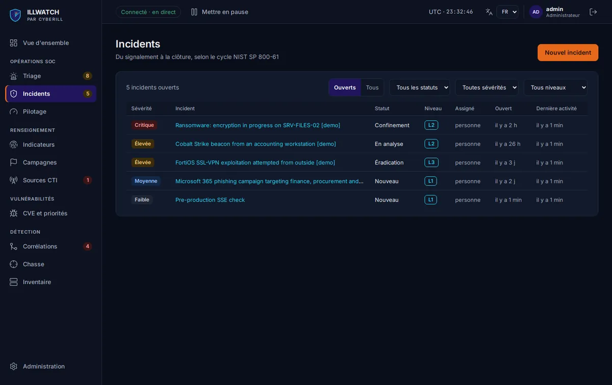

---

## 7. Chasse aux menaces

**À quoi elle sert.** Les alertes vous disent ce qui est connu. La chasse part à la recherche de
ce qui ne l'est pas encore, avec des questions de terrain : « une de ces adresses vues par notre
proxy est-elle connue ? », « un de ces domaines ressemble-t-il à un domaine généré par un logiciel
malveillant ? ».

**Comment elle fonctionne.** Vous pouvez chasser sur des **observables soumis** (10 000 valeurs au
plus, normalisées comme des IOC) ou sur **toute la base** d'IOC actifs. Chaque exécution devient
une **session** enregistrée, que vous pouvez rouvrir plus tard. Si une règle échoue, la session
est marquée *partielle*, mais les autres règles vont au bout.

| Règle | Détecte | Sévérité |
|---|---|---|
| RULE-01 | relais de sortie Tor (liste officielle) | moyenne |
| RULE-02 | domaine chez un fournisseur de DNS dynamique gratuit | élevée |
| RULE-03 | domaine généré par algorithme (DGA), calibré sur les 100 000 premiers domaines Tranco | moyenne |
| RULE-04 | adresse d'infrastructure de rançongiciel connue | critique |
| RULE-05 | CVE critique à exploit public touchant un produit de l'inventaire | critique |
| RULE-06 | observable déjà connu comme IOC actif | celle de l'IOC |

Les règles sont versionnées, et chaque session garde la version qu'elle a appliquée : six mois
plus tard, vous saurez exactement avec quelles règles un résultat a été obtenu.

**Utiliser.** Écran **Chasse** (**Nouvelle chasse**) ; **Chasser depuis l'incident** sur la page
d'un incident ; `illwatch hunt run --observables proxy.txt` ; chasse quotidienne automatique.

**Lire le résultat.** Correspondances paginées, les plus graves d'abord, filtrables par règle et
sévérité, avec un lien vers l'IOC ou la CVE et le contexte ATT&CK.

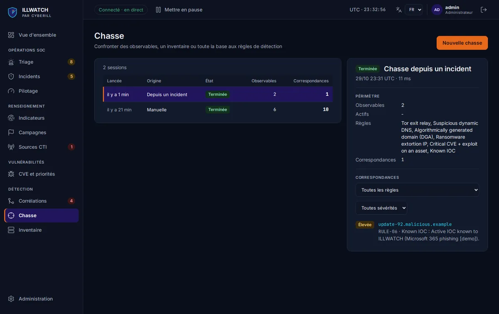

---

## 8. Contexte adverse : MITRE ATT&CK et campagnes

Derrière chaque indicateur, il y a quelqu'un. Comprendre comment il opère aide à anticiper son
prochain geste.

**MITRE ATT&CK** est le référentiel mondial des techniques d'attaque, la langue commune des
équipes de défense. Une fois importé (`illwatch attack import`), il donne à chaque détection sa
**technique** (règles de chasse, corrélations) et, quand la source le nomme en toutes lettres, le
**groupe** ou le **logiciel malveillant** cité.

Une **campagne** rassemble l'infrastructure d'une opération adverse (les IOC rattachés par valeur
ou par description) et, si on le connaît, l'acteur ATT&CK qui la mène. Cette **attribution par
l'infrastructure** se propage ensuite partout : dès qu'une correspondance de chasse, une
corrélation ou un incident touche un IOC de la campagne, la campagne et son acteur s'affichent.

| Action | Dans l'application | En ligne de commande |
|---|---|---|
| Importer ATT&CK | | `illwatch attack import` |
| Voir une technique | contexte affiché dans les détections | `illwatch attack show T1190` |
| Créer une campagne | **Campagnes**, **Nouvelle campagne** | `illwatch campaigns create "…" --actor S0650` |
| Rattacher l'infrastructure | **Rattacher de l'infrastructure** | `illwatch campaigns attach "…" --contains "Qakbot"` |

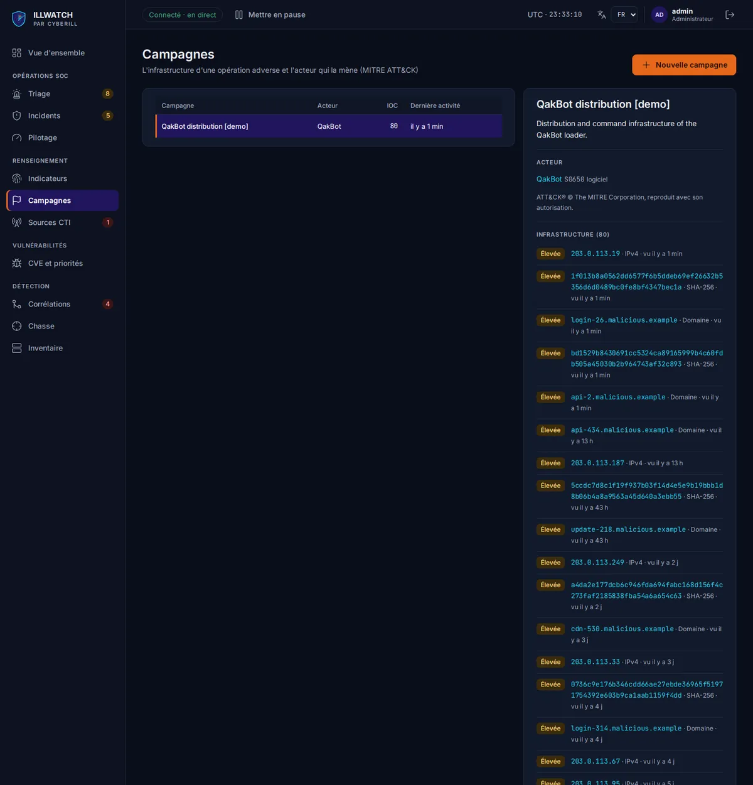

---

## 9. Partage et exports

Le renseignement gardé pour soi protège une organisation ; partagé, il en protège plusieurs.
ILLWATCH parle les formats standards, pour que vos données circulent sans ressaisie :

| Besoin | Format | Méthode |
|---|---|---|
| Analyse dans un tableur | CSV (RFC 4180), cellules protégées contre l'injection de formule | **Exporter** (Indicateurs), `illwatch dashboard export` |
| Échange entre outils | JSON (RFC 8259) | `illwatch dashboard export … --format json` |
| Renseignement structuré | bundle STIX 2.1 (identifiants stables) | `illwatch stix export`, `GET /api/v1/stix/bundle` |
| Flux continu vers un SIEM, OpenCTI, MISP | serveur TAXII 2.1 en lecture seule : collections « indicateurs » et « campagnes » | compte **Lecteur** dédié, `https://<domaine>/taxii2/` |
| Inventaire | Excel ou CSV réimportable | **Exporter (Excel)**, `illwatch assets export` |

Chaque export laisse une trace au journal d'audit (`data.export`), et les IOC que vous avez
exclus ne quittent jamais la plateforme.

---

## 10. Pilotage et tableau de bord

**Vue d'ensemble.** D'abord ce qui demande votre attention, ensuite l'état de la plateforme : file
prioritaire, incident le plus grave, IOC actifs, CVE prioritaires, alertes, santé des sources,
évolution de la menace sur 24 heures, 7 ou 30 jours, CVE par priorité, activité récente, IOC par
type. Inutile de rafraîchir la page : tout se met à jour **en direct** (flux d'évènements du
serveur).

**Pilotage SOC.** Pour le responsable qui doit rendre des comptes, sur 7 ou 30 jours : MTTA (délai moyen d'ouverture à prise en charge), MTTR
(délai moyen de résolution, et médiane), incidents dans le délai cible par sévérité, liste des
dépassements, incidents par niveau et escalades, charge par analyste, ouverts et clos par jour,
faux positifs écartés.

**Qualité des alertes (ADR-029).** Une règle peut détecter juste sur un jeu de test et pourtant
noyer l'équipe sous le bruit. Le même écran répond donc à une autre question : sur la période,
que sont devenus les signaux de chaque règle ? Pour chaque déclencheur d'alerte CVE, règle de
corrélation et règle de chasse, il compte les signaux **confirmés** (un incident a été ouvert),
les **faux positifs** (qualifiés par un analyste ou mis en liste d'exclusion), les **ignorés**
(acquittés sans suite), ceux **clos par le moteur** et ceux **en attente**. Il en déduit la
**précision** (confirmés sur confirmés et faux positifs), la part de **bruit** et le **délai
de traitement** médian. Par source, il montre combien d'IOC ont déclenché une corrélation ou une
chasse, combien ont été confirmés dans un incident et combien ont été exclus : de quoi ajuster
la fiabilité d'une source sur des faits.

| Indicateur | Calcul |
|---|---|
| Précision | confirmés / (confirmés + faux positifs) ; absente tant que rien n'est qualifié |
| Bruit | (faux positifs + ignorés) / signaux traités par un analyste |
| Délai de traitement | de l'apparition du signal au geste de l'analyste (acquittement, faux positif, incident) |

Les chasses quotidiennes retrouvent chaque jour les mêmes valeurs : elles sont donc comptées
par observable distinct. Rien n'est stocké en plus : chaque chiffre se recalcule à partir des
évènements, alertes, incidents et exclusions existants.

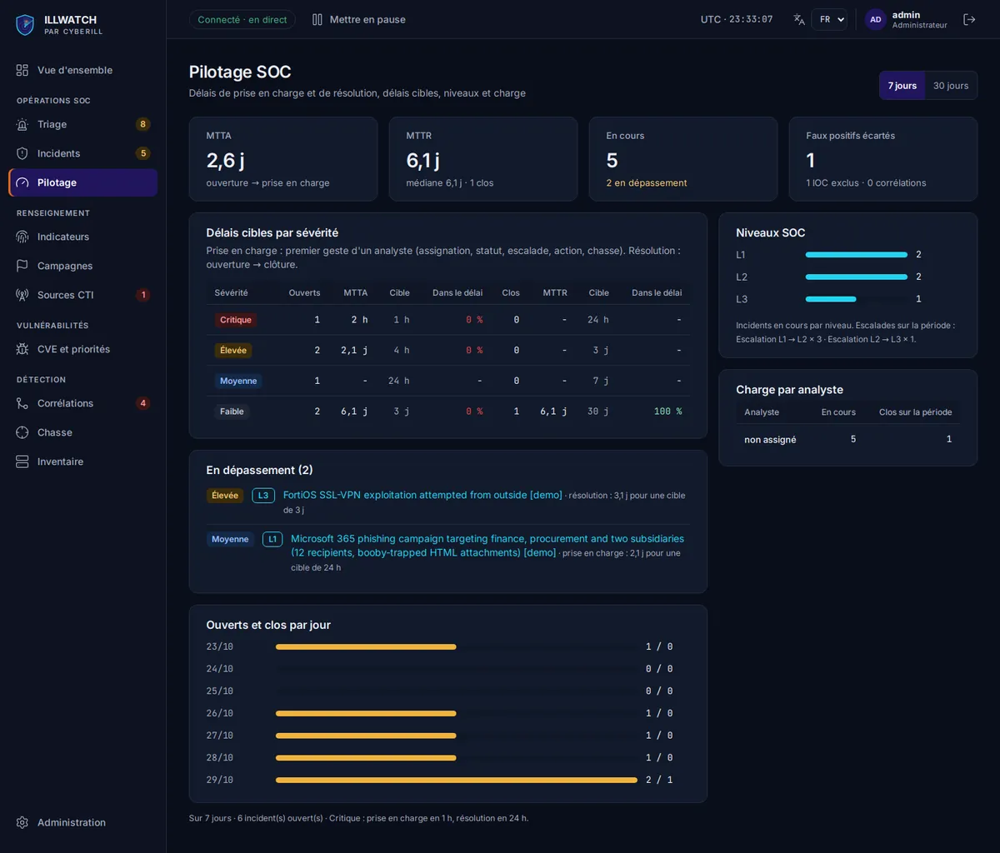

`illwatch soc metrics --days 30`, `illwatch soc quality --days 30` et `illwatch dashboard show`
donnent les mêmes chiffres en console.

---

## 11. Administration, audit et sécurité

Une plateforme qui centralise votre renseignement et votre surface exposée devient elle-même une
cible. Elle se défend donc comme telle :

| Mesure | Ce qu'elle garantit |
|---|---|
| Mots de passe Argon2id, 12 caractères au moins | résistance au vol de la base |
| Jeton d'accès de 15 minutes, jeton de rafraîchissement rotatif | un jeton rejoué révoque toute la session |
| Limitation des connexions | 5 échecs d'une adresse sur un compte, 50 sur un compte, 20 d'une adresse : refus en 429, sans bloquer le titulaire légitime |
| Rôle relu en base à chaque requête | une désactivation prend effet immédiatement |
| Rôle PostgreSQL applicatif sans droit de structure | même compromise, l'application ne peut ni modifier le schéma ni effacer l'audit |
| Journal d'audit en ajout seul | connexions, refus, administration, exports, chasses, inventaire, avec l'auteur, l'adresse et l'identifiant de requête |
| Protection SSRF, réponses plafonnées | une source hostile ne peut pas viser le réseau interne |
| En-têtes HTTP stricts, HTTPS par Caddy | navigateur protégé, `/docs` masqué en production |

L'écran **Administration** réunit les comptes, le journal d'audit (filtres par famille
d'actions et par résultat), les paramètres en vigueur (sans secret) et les demandes de
démonstration.

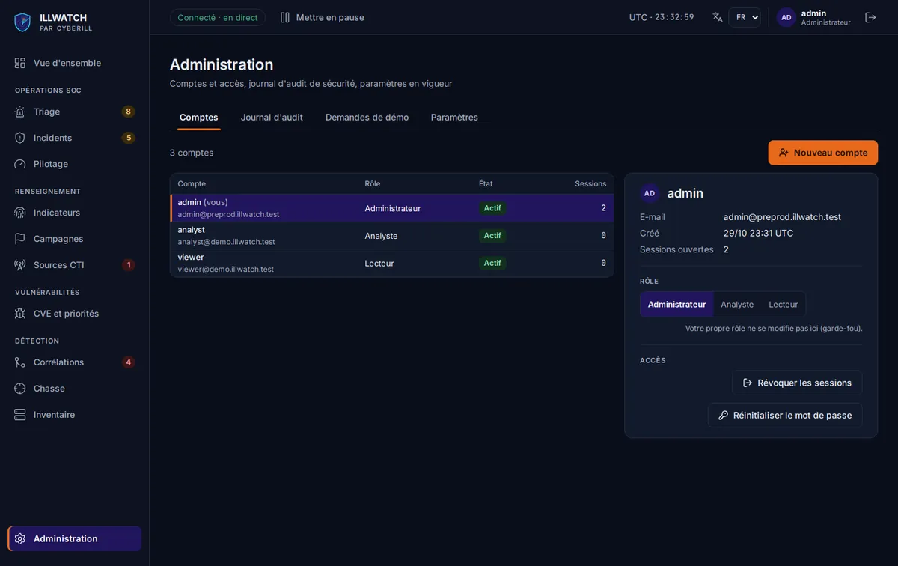

---

## 12. Ce que la plateforme fait seule

Pendant que vous dormez, ILLWATCH continue de travailler. Voici ce qu'il fait sans qu'on le lui
demande, et le réglage qui permet d'en changer le rythme :

| Tâche | Fréquence | Réglage |
|---|---|---|
| Collecte de chaque source | selon la source (1 heure par défaut) | `DEFAULT_POLLING_INTERVAL`, écran Sources CTI |
| Synchronisation KEV, NVD, EPSS et recalcul des scores | toutes les 6 heures | `CVE_SYNC_INTERVAL_SECONDS` |
| Alerte et webhook | au franchissement du seuil | `RISK_ALERT_THRESHOLD`, `ALERT_WEBHOOK_URL` |
| Corrélation inventaire × CVE × IOC | chaque heure | `CORRELATION_INTERVAL_SECONDS` |
| Chasse sur toute la base | chaque jour | `HUNT_INTERVAL_SECONDS` |
| Mise à jour de DB-IP | chaque mois | `ENRICHMENT_AUTO_UPDATE` |
| Entretien : sessions expirées, journal des collectes au-delà de 90 jours, fraîcheur EPSS | chaque jour | |
| Expiration des IOC | en continu | durées par type |

---

## 13. Parcours types

Les fonctionnalités prennent leur sens quand on les voit enchaînées. Voici cinq situations que
toute équipe de sécurité finit par vivre, et la façon dont ILLWATCH les accompagne.

### 13.1 Le lundi matin d'un analyste

L'analyste arrive, ouvre ILLWATCH, et en quelques minutes sait où mettre son énergie.

1. **Vue d'ensemble** : 8 alertes, un incident critique en confinement.
2. **Triage** : deux alertes P1 venues du catalogue KEV. L'une touche un produit absent du parc :
   il l'**acquitte**. L'autre concerne la messagerie : il **ouvre l'incident**.
3. **Corrélations** : CORR-01 sur « Messagerie » (Exchange Server, version déclarée dans la plage
   vulnérable). Il ouvre l'incident depuis l'évènement, qui reprend la CVE.
4. **Incidents** : il s'assigne l'incident, le passe en *Analyse*, puis l'**escalade en L2** avec
   le motif « serveur exposé, version vulnérable confirmée ».

### 13.2 Une CVE critique fait la une

La presse parle d'une faille FortiOS, la direction s'inquiète. Il faut une réponse claire, vite.

1. **CVE et priorités** : recherche « fortios » ; la CVE est en P0, au catalogue KEV depuis hier.
2. **Corrélations** : **Corréler maintenant** ; CORR-01 se lève sur « Pare-feu siège ».
3. L'incident est ouvert, le correctif appliqué, l'action déclarée dans la chronologie. L'incident
   passe ensuite en *Récupération*, puis en *Clôture* avec son résumé. La direction a sa réponse,
   et la preuve qui va avec.

### 13.3 Un nouvel équipement entre dans le parc

Un nouveau serveur arrive. Pour qu'il soit surveillé dès aujourd'hui :

1. **Inventaire**, **Exporter (Excel)** ; ajout d'une ligne ; **Importer un fichier**,
   **Analyser** : « 1 actif à créer » ; **Importer**.
2. `illwatch cves refresh-affected` pour les plages de versions, puis **Corréler maintenant**.

### 13.4 Un faux positif revient sans cesse

L'adresse du résolveur DNS public de l'entreprise déclenche une correspondance à chaque chasse.
Au bout de la troisième fois, on règle la question pour de bon : sur sa fiche, **Marquer comme
faux positif**, avec le motif « résolveur public de l'entreprise ». L'IOC reste en base pour
l'historique, mais il n'est plus ni chassé, ni corrélé, ni partagé. Seul un administrateur peut
retirer l'exclusion.

### 13.5 Un partenaire veut recevoir nos IOC

Une entité voisine souhaite profiter de votre renseignement. L'administrateur crée un compte
**Lecteur** dédié (`siem-partenaire`), puis transmet l'adresse `https://<domaine>/taxii2/` et les
identifiants par un canal sûr. Le partenaire lit les collections « indicateurs » et
« campagnes », sans pouvoir rien modifier. Et si la collaboration s'arrête, son compte se
désactive seul, sans toucher aux autres.

---

## 14. Glossaire

La sécurité aime les sigles. Voici ceux que vous croiserez dans ILLWATCH :

| Terme | Définition |
|---|---|
| **ATT&CK** | référentiel MITRE des techniques d'attaque (T1190 : exploitation d'une application exposée) |
| **CVE** | identifiant unique d'une vulnérabilité publiée (CVE-2021-44228 : Log4Shell) |
| **CVSS** | note de gravité technique d'une vulnérabilité, de 0 à 10 |
| **DGA** | algorithme de génération de domaines utilisé par des logiciels malveillants |
| **EPSS** | probabilité qu'une CVE soit exploitée dans les 30 jours, de 0 à 1 (FIRST) |
| **IOC** | indicateur de compromission : adresse IP, domaine, URL, empreinte de fichier, e-mail |
| **KEV** | catalogue CISA des vulnérabilités déjà exploitées dans la nature |
| **MTTA, MTTR** | délai moyen de prise en charge, délai moyen de résolution |
| **NIST SP 800-61** | guide américain de gestion des incidents, référence du cycle des incidents |
| **SSRF** | attaque qui fait émettre au serveur des requêtes vers son propre réseau |
| **STIX, TAXII** | format standard du renseignement sur les menaces, et protocole pour l'échanger |
| **L1, L2, L3** | niveaux d'un SOC : qualification, investigation, traitement avancé |
