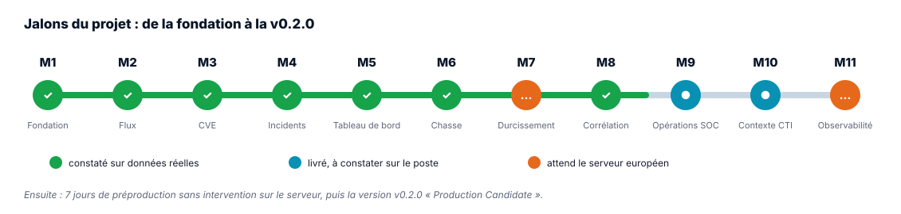
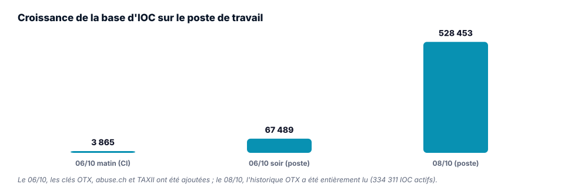

# ILLWATCH : Feuille de route

| | |
|---|---|
| **Version** | **v2.0 du 30/10/2026** |
| **Version du logiciel** | `0.2.0.dev0` sur `main` ; dernière release `v0.1.1` (baseline M1 à M6) |
| **Objectif** | v0.2.0 « Production Candidate », puis la suite décrite en [section 5](#5-apres-la-v020) |

**Règle de conduite.** Un jalon est clos quand ses **critères de sortie sont constatés**, pas
quand le code est fusionné. Chaque jalon part d'une branche créée depuis `main` et se termine par
un bilan dans `Rapport/` et, pour les versions, un tag.

## Sommaire

1. [Où en est le projet](#1-ou-en-est-le-projet)
2. [Jalons M1 à M6 : la plateforme fonctionnelle](#2-jalons-m1-a-m6-la-plateforme-fonctionnelle)
3. [Jalons M7 à M11 : vers la v0.2.0](#3-jalons-m7-a-m11-vers-la-v020)
4. [Ce qui reste à faire, dans l'ordre](#4-ce-qui-reste-a-faire-dans-lordre)
5. [Après la v0.2.0](#5-apres-la-v020)
6. [Calendrier](#6-calendrier)

---

## 1. Où en est le projet

| | État au 30/10/2026 |
|---|---|
| **Constaté sur données réelles** | M1 à M6, M8 ; scénario SOC 48/48 ; 528 453 IOC et 26 416 CVE sur le poste de travail |
| **Livré, à constater sur le poste** | M9 (opérations SOC), M10 (contexte adverse) ; import d'inventaire Excel (ADR-028) |
| **Livré, attend le serveur européen** | M7 (HTTPS sur domaine public, note SSL Labs), M11 (7 jours de préproduction) |
| **Qualité** | deux pipelines CI (GitLab, GitHub), plus de 670 tests, couverture d'environ 94 %, validation sur données réelles chaque lundi, préproduction et captures à chaque modification |
| **Documentation** | guide d'installation, manuel fonctionnel, cahier des charges, vision et feuille de route en version 2.0 ; 28 ADR |

---

## 2. Jalons M1 à M6 : la plateforme fonctionnelle

| Jalon | Contenu | Critère de sortie | État |
|---|---|---|---|
| **M1** Fondation | configuration validée, migrations, comptes, rôles, CLI | schéma, API, rôles, audit | ✅ constaté |
| **M2** Flux de menaces | 5 formats, 9 sources, dédoublonnage, provenance, worker | au moins 500 IOC, 3 sources saines, OTX et STIX connectés | ✅ constaté le 06/10 |
| **M3** Moteur CVE | NVD, KEV, EPSS, score composite, alertes | NVD de moins de 24 h, KEV de plus de 1 000, EPSS de plus de 90 % | ✅ constaté le 06/10 |
| **M4** Incidents | cycle NIST à 6 états, chronologie immuable | un incident mené jusqu'à la clôture | ✅ constaté |
| **M5** Tableau de bord | synthèse, activité, exports | scénario SOC | ✅ constaté |
| **M6** Chasse | 6 règles, sessions | session terminée avec correspondances | ✅ constaté (339 en CI) |

Release `v0.1.1` publiée le 06/10/2026 (image `ghcr.io/godwillfoka/cyberillsec-illwatch:0.1.1`).

---

## 3. Jalons M7 à M11 : vers la v0.2.0

Le test d'acceptation de la v0.2.0 suit un parcours complet : source de renseignement, ingestion,
normalisation, enrichissement, corrélation, détection, alerte, incident, investigation, chasse,
ATT&CK, tableau de bord, résolution, piste d'audit. Il est automatisé par
`scripts/scenario_soc.py` et rejoué en CI.

### M7 : Durcissement de production

**But.** Rendre ILLWATCH déployable sans réserve de sécurité connue.

| Lot | Contenu | État |
|---|---|---|
| 1 | audit en ajout seul, `/ready`, en-têtes HTTP, identifiant de requête, verrouillage compte × adresse, sauvegarde et restauration | ✅ constaté le 03/10 |
| 2 | rôles PostgreSQL séparés, Redis protégé, rotation de clé, sessions révocables | ✅ constaté le 04/10 |
| 3 | Caddy (HTTPS), analyse d'image, migrations éphémères, entretien quotidien | ✅ TLS constaté en local ; outillage `deploy-vps.sh` prêt |
| Interface (ADR-016) | 12 écrans temps réel, identité ILL Watch v2, 5 langues | ✅ utilisée sur données réelles |
| Inventaire en fichier (ADR-028) | import et export Excel ou CSV, aperçu, tout ou rien | 🟢 livré le 30/10 |
| Rédaction | ni tiret long ni tiret moyen, garde-fou en CI | 🟢 livré le 30/10 |

**Critère de sortie** : pile de production sur un serveur européen, note SSL Labs A ou mieux
(workflow « Clôture M7 »). **Reste** : louer le serveur et le nom de domaine.

### M8 : Détection et corrélation

Confiance des IOC (ADR-017), enrichissement hors ligne (ADR-019), inventaire et corrélation
CORR-01 à 03 (ADR-020), comparaison des versions (ADR-021), plages CIDR, plateforme de l'actif,
calibration DGA sur Tranco. **Critère** : 100 % des cas attendus détectés sur jeu figé, taux de
faux positifs publié. ✅ **Clos le 14/10/2026** : 100 % détectés, 0 % de faux positifs ; sur
données réelles, 38 évènements de la première passe, 37 clos par la comparaison des versions.

### M9 : Opérations SOC

Niveaux L1, L2, L3 et escalade, liste d'exclusion des faux positifs, chasse depuis l'incident,
recommandations de réponse, règles versionnées, écran Pilotage (ADR-022). **Critère** : un
incident traverse L1, L2 et L3 sans quitter ILLWATCH, MTTR mesuré. 🟢 **Constaté en CI** ; à
rejouer sur le poste.

### M10 : Contexte adverse

Référentiel MITRE ATT&CK (ADR-023), campagnes et attribution par l'infrastructure (ADR-024),
export STIX 2.1 et serveur TAXII 2.1 (ADR-025). **Critère** : une alerte affiche sa technique
ATT&CK et, si connu, l'acteur. 🟢 **Constaté en CI** ; à constater sur le poste après
`illwatch attack import`.

### M11 : Observabilité et déploiement

`/metrics`, Prometheus et Grafana (10 alertes, 2 tableaux), acceptation en CI sur jeu figé,
restauration testée chaque mois, environnements de développement, préproduction et production
(ADR-026). **Critère** : 7 jours de collecte continue en préproduction sans intervention,
tableaux complets, restauration testée. **Reste** : les 7 jours, sur le serveur de M7.

---

## 4. Ce qui reste à faire, dans l'ordre

| # | Tâche | Qui | Dépend de | Effort |
|---|---|---|---|---|
| 1 | Relire et fusionner la demande de fusion « Inventaire Excel/CSV, ponctuation, documentation v2 » | porteur | CI verte | 1 h |
| 2 | Sur le poste : `git pull`, `pip install -c constraints.txt -e ".[dev]"`, `illwatch db upgrade`, `./scripts/build-web.sh`, `illwatch attack import`, redémarrer API et worker | porteur | 1 | 30 min |
| 3 | Déclarer l'inventaire réel avec le modèle Excel, puis `illwatch cves refresh-affected` et `illwatch correlate run` | porteur | 2 | 1 à 2 h |
| 4 | Constater M9 (escalade L1 à L3, Pilotage) et M10 (ATT&CK, campagne, `curl /taxii2/`) sur le poste ; rédiger les bilans | porteur | 2 | 2 h |
| 5 | Suspendre RedEye tant que son serveur ne répond pas ; régler le fuseau horaire de la machine virtuelle | porteur | | 15 min |
| 6 | Louer un serveur européen (2 cœurs, 4 Go, 40 Go) et un nom de domaine ; `deploy-vps.sh install` ; inscrire le domaine dans `deploy/vps-domaine.txt` | porteur | | 2 h |
| 7 | Constater la note TLS (workflow « Clôture M7 ») : **M7 clos** | CI | 6 | automatique |
| 8 | 7 jours de préproduction sans intervention, restauration du mois : **M11 clos** | serveur | 6 | 7 jours |
| 9 | Tag `v0.2.0`, release, image publiée | porteur | 7, 8 | 1 h |

---

## 5. Après la v0.2.0

| Thème | Contenu | Priorité |
|---|---|---|
| Multi-organisation et SSO | plusieurs organisations sur une instance, OIDC | haute |
| Cyberill TI Cloud | offre hébergée dans l'UE | haute |
| Assistant d'analyse | modèle de langage et recherche augmentée sur bulletins et incidents | moyenne |
| Connecteurs de parc | GLPI, CMDB, pour l'inventaire | moyenne |
| Règles Sigma | import depuis les collections TAXII | moyenne |
| Facteur CWE dans le score | ADR à rédiger, rééquilibrage des poids | basse |
| Site de présentation | relecture native des 5 langues, mentions légales, hébergement à côté de l'application | moyenne |

---

## 6. Calendrier

| Période | Jalons |
|---|---|
| juillet à septembre 2026 | cadrage, cahier des charges, M1 à M6 |
| 03/10 au 06/10/2026 | audit global, M7 lots 1 à 3, release `v0.1.1`, M2 et M3 constatés |
| 08/10/2026 | renommage SENTRY → ILLWATCH |
| 10/10 au 15/10/2026 | interface web, M8 clos, M9, M10 et M11 livrés |
| 22/10 au 24/10/2026 | site de présentation en 5 langues, demandes de démonstration |
| 30/10/2026 | inventaire en fichier, ponctuation, documentation v2.0 |
| novembre 2026 (cible) | serveur européen, M7 et M11 clos, `v0.2.0` |
